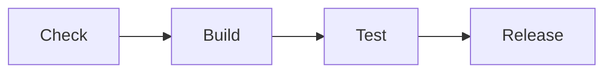

# Inline Mermaid for DSH

Inline Mermaid renders `mermaid` and `mmd` code fences in the DSH chat. It
waits briefly for the source to settle, preserves the original DSH code block
and Copy control, and leaves the source visible if rendering fails. A button
switches between the diagram and the source.

Mermaid is bundled locally. Diagrams are rendered in a sandboxed frame with a
restrictive content security policy and shown as SVG images. The frame has no
access to the DSH document or network.

## Build and install

From this package directory, run `npm ci --ignore-scripts` and `npm run build`.
To install from DSH, run `npm pack --ignore-scripts` and choose the generated
`.tgz` in **Plugins → Add plugin**. For a linked Windows Desktop installation,
exit DSH and run `install-desktop.ps1`, then reopen DSH.

Try this in a DSH chat.

This bundle identifies fences by DSH's code-block markup. A future DSH release
that changes that markup may require an update to the handler.

## Browser smoke check

After building, serve this package directory over localhost and open
`tests/fixture.html`. It loads the generated plugin client through a minimal
DSH loader stub and shows a Mermaid code fence. Verify the diagram appears,
then use **Diagram actions** to show the source and expand the diagram. The
source remains available if rendering fails. This checks the browser bundle;
the installed DSH chat markup still needs checking after a DSH update.
