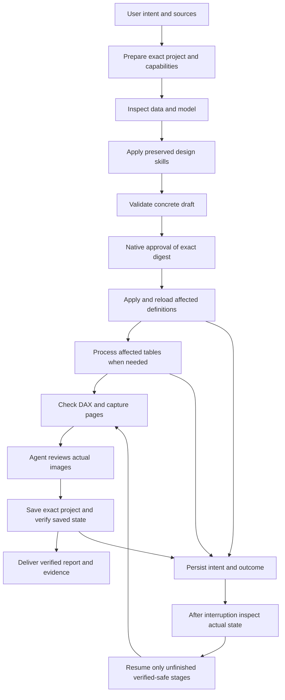

# Current improvement — 0.6.1

- `pbi_prepare_draft` accepts a local JSON `manifestPath`. Definition entries accept `contentPath` instead of inline file bodies; the five-tool interface is unchanged.
- Manifests are checked against the same tool schema before planning or changing revision history. Bounded UTF-8 reads, contained roots, no symlinks/junctions, duplicate-target checks, explicit baseline hashes and optional content hashes are enforced.
- Loaded definitions are captured once and passed through existing authenticated staging and validation. Draft-source hash/count receipts persist without returning file bodies to the model.
- Failed staged validation now stops before reporting ready_to_execute. Generator scripts are not executed. Live project validation, checkpoints, design rules and recovery remain in place.
- The purpose is smaller model tool arguments during generated report authoring; this does not alter provider/network timeout settings.
- Validation: 70 Node tests passed, including registered-tool/coordinator integration, immutable staging snapshots, prior-draft preservation, schema rejection and content budgets. The installed DSH JSON validator passed; package audit includes the loader and guide without runtime artifacts. No browser UI changed, so native tool/HTTP integration tests are the applicable coverage.

# Current delivery — 0.6.0

The user requested a tools-only chat workflow and removal of all Power BI sidebar UI and manual approval requirements. This supersedes the historical sidebar/approval decisions recorded below.

- Removed the DSH client registration, launcher, sidebar tab, embedded Designer and Agent Performance page, static UI routes, UI build pipeline and obsolete browser tests/dependencies. A no-op client entry point handles cached host metadata.
- Validated drafts proceed through exact-digest task authorization on the private host channel. No sidebar or separate approval is required. Existing native authorization records remain readable for recovery.
- Preserved validation, project/session/source checks, unsaved work checks, checkpoints, journals, output serialization protection, design skills and evidence requirements.
- Added coordinator protocol migration so persistent old processes cannot trap the new workflow in the old approval-only API. Existing records are preserved.
- All questions and feedback stay in chat. No independent background agent or newly qualified unattended native Save is claimed.

Validation: 59 Node tests and 76 Python tests passed, including automatic task authorization, lost-acknowledgment reconciliation, absence of sidebar registration, protected HTTP authorization and removed web routes. The installed DSH JSON validator accepted workflow fixtures. Package audit confirms no UI assets are shipped. DSH must restart to unload its previously running sidebar client.

## Historical implementation record

# Power BI workflow simplification

Status: source implementation and automated suites complete; live model/render qualification passed; final native Save and full DSH task integration remain pending. Scope: local source changes; no installation, publication, or edits to user reports during development.

## Implementation record
- Implemented: five default task tools; automatic coordinator startup/reuse; Store/standalone executable discovery; exact project selection/open preflight; new PBIP and empty local model scaffolding; persistent checksummed context and fsynced operation journal; per-task and per-project execution locks; native digest approval reuse; apply/reload/refresh readback reconciliation; bounded analytical queries; artifact hash review and saved-state gates; optional exact-PID Save with bridge readback and interruption reconciliation; task revisions with retained history; direct data-only refresh; all four original design skills retained.
- Compatibility: `advancedTools: true` restores low-level tools. Native sidebar approval is unchanged. Managed tasks persist connection metadata across host reloads; no token contents are returned to the agent.
- Deliberate limitations: the bundled bridge has no save API. An optional exact-PID Windows Save fallback is implemented and unit-tested; native dispatch and final persistence have not yet been qualified live; this release does not claim fully unattended completion. It does not run a background AI agent after the host stops. Arbitrary source/model authoring still uses the agent and the preserved skills, not a hardcoded dataset generator. Remote Fabric and unsupported file formats remain explicit capability limitations. Interrupted staging without an acknowledged backend ID requires inspection; it is not guessed or replayed.
- Validation: 55 Node tests and 73 Python tests passed on 2026-11-22, including interruption, approval and state checks; package module inclusion and diff whitespace checks passed. A real isolated Desktop model imported three rows and passed independent DAX checks (Rows=3, Total=60); both report pages were captured and visually inspected. Full DSH approval-to-saved-report completion remains separate integration acceptance. The Desktop window became unavailable before the final save check; the cause has not been established. No frontend was changed; browser e2e does not drive the native DSH host or Desktop bridge.

## Outcome
Provide a small agent interface over the existing guarded execution backend. Support task-specific plans for existing PBIP projects and new reports from supplied sources. Preserve the four dashboard design skills, exact native-user approval, unsaved-work protection, and explicit unsupported-capability reporting.

## Implementation sequence
1. Introduce a durable, versioned task context and append-only operation journal. Persist project identity, decisions, design skills, dependency graph, acceptance checks, artifacts, outcomes, and next actions. Atomic snapshots; session isolation; no credentials or private reasoning.
2. Add a capability-driven task API: prepare, inspect, prepare draft, execute approved draft, inspect task. Reuse existing change-set approval/application/reload/processing/capture operations. Low-level tools remain compatible but legacy disabled tools leave the advertised agent surface.
3. Automate dependency discovery and coordinator startup for supported local projects. Resolve bundled CLI and Store/standalone Desktop paths; select unused loopback ports without terminating other processes. Scaffold new projects from explicit output locations; ambiguity and unsupported hosts remain actionable blockers.
4. Build resumable execution with intent recorded before dispatch. Reconcile interrupted or timed-out operations before retry; no blind replay of writes. Keep report redraw, model-definition reload, and data processing separate. Do not overwrite unsaved work or weaken digest-bound approval.
5. Integrate design workflow and acceptance evidence. Preserve analysis-report-workflow, dashboard-design-process, dashboard-design-patterns, dashboard-design-review. Completion requires explicit checks, current captures/review, data/calculation evidence where relevant, and saved-output evidence; mocked or structural validation is insufficient.
6. Validate with focused Node/Python tests, project-required suites, and e2e MCP for supported UI surfaces. Exercise general projects and workflows, not a dataset-specific implementation. Real Desktop checks are separately reported and never inferred from fixture tests.

## Recovery requirements
- A timeout is unknown, not failure. Persist unfinished operations and reconcile actual state before any replay.
- Interruptions after successful refresh must not trigger duplicate import or model-definition reload.
- Changed source/model/project/digest invalidates dependent steps and approval as appropriate.
- Routine authorized operations proceed without repeated confirmation. Required native approval is one concrete review; authentication and conflicting unsaved work are explicit handoffs.
- Logs are bounded/readable, redact secrets, and expose concise next actions.

## Test matrix
Existing report formatting; model/schema changes; new raw-source project; data-only refresh; multiple Desktop instances; Store installation; unavailable dependency; wrong project; stale approval; schema failures; cyclic/import errors; timeout before/after dispatch; restart after refresh; partially completed tables; capture mismatch; unsaved changes; cross-session access; context corruption; concurrent execution; source changes; missing semantic/visual/saved evidence.

## Delivery and limitations
Document implemented versus deferred capabilities in this file and README. Preserve unrelated checkout edits. Do not claim an unattended live report completed until a real Desktop integration run satisfies its acceptance checks. Do not deploy/reinstall the shared plugin without a separate requested installation step.

## Execution and recovery map

## Live qualification evidence — 2026-11-22
- Isolated project: `D:\DSH\powerbi-workflow-qualification\run-20261122\WorkflowQualification.pbip`.
- Schema validation: zero errors and warnings; offline model validation passed.
- Live import and independent numeric checks: `D:\DSH\powerbi-workflow-qualification\live-model-result.json`.
- Captured and inspected: `evidence/Synthetic overview.png` and `evidence/Synthetic records.png` under the qualification directory. These are synthetic execution evidence, not production dashboard design acceptance.
- Optional save dependencies installed into this checkout's isolated `.runtime/python`; capability probe passed. Actual native helper dispatch is unverified.
- The installed desktop profile already links this source checkout. Restarting DSH is required to load changed host modules; the running user host was not terminated.
- Full unattended qualification still requires the active DSH agent to prepare a draft, receive exact native approval, execute, review images, save, and confirm persistence. Authentication, ambiguous semantics, and conflicting user work remain explicit handoffs.
- The required test commands passed with loopback access enabled; sandbox-only HTTP failures were environmental and did not occur in the permitted rerun. No supported browser/mobile UI changed, so the native checks above supplement the host fixtures rather than claiming browser e2e coverage.

## Serialization incident fix — 0.5.1
- Reproduced the reported failure using the exact `snapshotJsonValue` validator extracted read-only from the installed DSH archive. Undefined optional properties in task-status output fail before the text renderer executes.
- Omit absent task-status fields and enforce plain finite JSON at every registered tool result, including compatibility tools. Reject unsupported numeric evidence with a diagnostic; never replay an operation because its output is invalid.
- Added tests for nested missing fields, non-finite numbers, negative zero, cycles, sparse arrays, getters, unsupported objects, synchronous/asynchronous errors, one-time dispatch and prepared/resumed registered tools.
- 60 Node regression tests passed. The actual installed DSH validator accepted corrected empty/prepared/inspected/drafted/executed/finished/status fixtures. A full live report run remains separate from this serialization qualification.
- Preserved the five-tool default, optional compatibility tools, saved task context, design skills and Agent Performance UI. Existing advanced tools remain disabled by default; deleting them would not fix the root cause.
