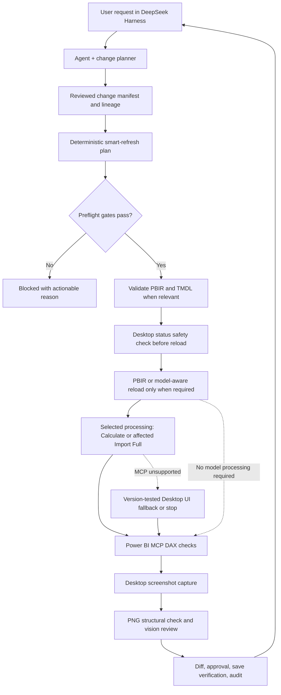

> Historical v0.2 design guide. For current 0.4.2 behavior and commands, use the package README one directory above.

# Power BI Live Designer for DeepSeek Harness

## Complete implementation guide, revision 0.2: Smart affected-table refresh

**Updated:** 5 November 2026
**Platform:** Windows, Power BI Desktop, PBIP/PBIR/TMDL projects, DeepSeek Harness Desktop
**Requested policy:** `smart` refresh, `affected` table scope, DAX checks enabled, screenshot checks enabled
**Delivery:** Local preview service, refresh-planning API, opt-in MCP execution adapter, optional Windows Save automation, code, tests and rollout instructions
**Engineering maturity:** Prototype and reference architecture, not a certified Desktop production integration

> **Read this first.** This guide contains working prototype code and supported Microsoft workflows, but the actual integration with Power BI Desktop, the installed Microsoft MCP server, and Windows UI Automation has **not** been exercised on a Windows machine in this authoring environment. Automated tests use simulated Power BI CLI results. Automated report screenshot *capture* and basic PNG validity checks work in the prototype; AI visual interpretation and numerical business-value assertions still require integration with an agent or an assertion engine. The provided MCP adapter is deliberately **disabled until a user maps the installed MCP schemas and validates the selected Desktop version**. This distinction prevents a misleading claim that unsupported model processing succeeded.

## Contents

1. Requirements and target user experience
2. Confirmed capabilities and important support boundaries
3. System architecture
4. Smart refresh decision model
5. Exact end-to-end orchestration
6. Model processing via Power BI Modeling MCP
7. Windows Desktop UI Automation and fallback flows
8. DAX verification and visual verification
9. Installation and configuration
10. Operator workflow and example manifests
11. Local API specification
12. Error states, rollback, recovery, and safety
13. Source code of the revised prototype
14. Automated tests and Windows validation plan
15. Integration with DeepSeek Harness and native-plugin roadmap
16. Security and deployment guidance
17. Acceptance criteria and phased roadmap
18. Primary documentation and references

---

## 1. Requirements and target experience

The user interacts in a single DeepSeek Harness workspace with two panes: an agent chat and a local Power BI screenshot preview. A request may change DAX, model metadata, Power Query, data sources, or report layout. The agent should identify the smallest required change, protect unsaved work, choose an appropriate refresh type, verify output, and show the updated report.

**Committed configuration for this revision:**

| Setting | Value | Effect |
|---|---|---|
| Refresh policy | `smart` | Do not import data merely because a visual or measure changed |
| Refresh scope | `affected` | Prefer the verified affected Import tables or partitions |
| Auto DAX verification | `true` | Execute relevant DAX test queries after processing; compare business values when expectations are supplied |
| Auto screenshot verification | `true` | Capture the affected page(s), check image format/dimensions, then queue visual review |
| Unsaved changes | Hard stop | Never override `hasUnsavedChanges: true` by reloading from disk |
| Source-data operations | Explicit and observable | No hidden full-model refresh |
| Processing fallback | Fail closed | Do not substitute unsupported XMLA processing or arbitrary UI clicks |
| External publishing | Outside scope | Requires a separate user-authorized workflow |

### 1.1 User stories

- "Make the Revenue card use net sales excluding canceled orders." Change the DAX measure, calculate if required by the chosen authoring workflow, execute DAX assertions, capture the report, and confirm the card changes.
- "Load the latest rows from Sales without reloading my entire dataset." Refresh the **verified** `Sales` Import table only if the selected refresh backend supports it, then check the values and visuals.
- "I added a column to the Sales SQL view." Change schema/model definition in the correct authoring surface, validate TMDL, reload model files, target-process the relevant table, and verify downstream visuals.
- "The report is wrong after yesterday's refresh." Reproduce the failure, inspect the appropriate model, source and visual state, avoid destructive edits, capture evidence, and propose the smallest correction.
- "This machine does not support Desktop XMLA processing." Stop, explain the limitation, and offer a version-tested Desktop UI refresh fallback. Never report success without proof.

### 1.2 Explicitly out of scope in the prototype

The preview is not a live embedded Power BI visual surface. It shows actual Desktop-generated screenshots. Clicking slicers within the preview is not yet routed to the Desktop window. Continuous remote desktop video and fully autonomous multi-step vision-driven diagnosis are also later-phase work. A native Cordis plugin bundle for Harness is not included: the working user interface uses the shipped Browser sidebar against localhost.

---

## 2. Confirmed capabilities and support boundaries

### 2.1 Three distinct refresh concepts

1. **Report/visual refresh:** Re-run queries used to display visual values. Import tables still reflect whatever data is already inside the model. A PBIR reload updates saved report layout definitions, not imported source data.
2. **Semantic-model definition reload:** Re-read TMDL and report definitions into Desktop. For a compatible Desktop Bridge/CLI, `--reload-with-model` performs this file-loading step. It is not data processing.
3. **Model processing and Import data refresh:** Execute recalculation or retrieve new data from the source and process affected objects. `Calculate` and `Full` are different processing types. For changed imported source fields and M expressions, the Microsoft authoring guidance calls for targeted `Full`, not merely `Calculate`.

Do not conflate these stages. A successful reload is not evidence that current source rows were imported. A successful DAX query is not automatically proof that business expectations were met. An image file existing is not automatically proof that no labels overlap.

### 2.2 Microsoft interfaces

- The **Power BI report-authoring CLI** owns PBIR inspection and validation, Desktop preview routing, status, `--reload`, `--reload-with-model`, and screenshot capture. The preview workflow requires an unsaved-state safety check before opening/attaching/reloading.
- The **Power BI Modeling MCP server** exposes connection, model, table, partition, measure, DAX and other modeling operation groups. Actual tool argument schemas are obtained from the running MCP server rather than guessed or hardcoded.
- **Power BI Desktop UI** supports visual refresh, data refresh, and per-table refresh choices depending on the installed build. Its UI is a practical fallback for operations that are unsupported through a particular Desktop external-tool path.
- **Windows UI Automation** and optionally Power Automate Desktop can operate visible Desktop controls, but their selectors depend on the version, language, window layout, modal dialogs and application state.

### 2.3 Important limitation and apparent documentation conflict

Microsoft's report-authoring skill describes using `RefreshWithXMLA` with `refreshType: Calculate` or targeted `Full` following model-aware reload, including in its Desktop authoring workflow. However, Microsoft's general **External Tools in Power BI Desktop** documentation states that sending processing commands to a model loaded in Desktop is not supported.

This guide treats the broader support guarantee as **unresolved for every Desktop build**. An unattended refresh controller must verify the installed adapter and supportability in a non-production test project, and it must not bypass an unsupported operation by sending raw XMLA or a lower-level bridge command. When support is unclear, use a tested Desktop UI refresh path or require a user step. Fabric service XMLA permissions and refresh APIs are a separate deployment architecture and do not grant Desktop functionality automatically.

### 2.4 PBIX vs PBIP

PBIX is a binary report format. Save as a Power BI project (`.pbip`) for the external-file authoring workflow. Do not rewrite PBIX internals directly. The TMDL/PBIR support matrix includes restrictions on some files and changes. The agent must inspect the current author's documentation and the project's actual format before changing files.

---

## 3. System architecture



The dashed processing fallback is **architectural**, not an unattended fallback in the included prototype. A failed selected-host CLI action is terminal unless Microsoft's machine-readable correction contract explicitly permits a correction. The controller must never automatically change hosts or bypass the authoring CLI after a failure.

### 3.1 Components and responsibilities

| Component | Ownership | Interfaces |
|---|---|---|
| DeepSeek chat agent | Request analysis, PBIP editing, change manifest, human approvals | Harness workspace filesystem and tool integrations |
| Refresh policy engine | Decide whether to reload, calculate, refresh Import data, or stop | Pure Python `build_plan()` |
| Coordinator | Serial execution, preflight, state transitions, audit and failure handling | `server.py` |
| PBIR authoring interface | Read/validate/preview report definitions | `powerbi-report-author` CLI |
| Model interface | Model edits, processing and DAX evaluation if supported | Microsoft Power BI Modeling MCP, tool schemas dynamically listed |
| Desktop UI bridge | Safe visible-window Save and tested manual fallback entry points | Windows UI Automation, optionally Power Automate Desktop |
| Browser sidebar | Preview, plan controls, explicit run approval and diagnostics | Local HTTP `127.0.0.1` |
| Verification layer | DAX test execution, screenshot integrity, agent visual review | MCP query operations, PNG checks, vision review |

### 3.2 Data/control boundary

Only the locally configured project path can be edited through the intended agent workspace. Browser requests cannot choose arbitrary subprocesses, remote endpoints, MCP tool names or project paths. The coordinator accepts only a restricted manifest. The MCP adapter reads an **operator-owned profile file** from disk, checks actual tool names and input schemas, and refuses execution unless the operator explicitly marked that profile as tested for the selected Desktop build.

The adapter profile is **not** a credential store. Keep source credentials and Microsoft authentication inside official connections, and never return raw data tables or secrets to the browser unless a specific development need is approved.

---

## 4. Smart affected-table refresh policy

### 4.1 Decision table

| Change type | Desktop definition reload | Processing action | Import data retrieval | Verification |
|---|---|---|---|---|
| PBIR visual formatting, position, layout | `--reload` | None | No | Screenshot + DAX smoke checks |
| TMDL measure, relationship, calculated object | `--reload-with-model` | `Calculate` when required by validated workflow | Usually no source reimport | DAX values and affected report pages |
| Live measure edit through MCP | No file reload | Model-specific calculation if required | No | DAX and report visual checks |
| Changed Import M expression or new source column | `--reload-with-model` | Targeted `Full` on verified tables or partitions | Yes | Query values, source freshness, affected pages |
| Import source changed, no model-file edit | None | Targeted `Full` | Yes | Query values, source freshness, affected pages |
| DirectQuery source changed | Usually none | Do **not** choose Import `Full` | Not applicable in Import sense | Trigger validated visual requery and DAX checks |
| Unknown lineage or storage mode | None | Block | No | Report why inference is unsafe |
| User requests all data refreshed | Deliberate separately approved workflow | Full-model or UI refresh, if supported | Yes | Per-table errors, timings, DAX and screenshots |

### 4.2 Dependency analysis, not guessing

To decide which tables are affected, inspect the semantic model and data lineage. A useful dependency graph includes tables, partitions, M expressions, source queries, relationships, calculated columns/tables, and DAX measure dependency references. For direct source changes, consider schema, storage mode, incremental refresh policy, join transformations and shared staging queries.

The **affected** scope means that the agent may not silently include other tables merely for convenience. It should return a precise list, explain dependencies, and request confirmation where the relationship cannot be established. If the requested isolated table refresh violates model consistency or has missing required dependencies, block and offer an explicit wider-scope plan.

Do not automatically infer table lineage by scanning PBIR JSON strings or by assuming a visual's first measure represents all data dependencies. Only use reliable schema/lineage evidence and record its source.

### 4.3 Required manifest and deterministic plan

The prototype accepts a reviewed manifest like:

```json
{
  "refreshPolicy": "smart",
  "refreshScope": "affected",
  "verifyDax": true,
  "verifyScreenshots": true,
  "changes": [
    {
      "kind": "source_data",
      "tables": ["FactSales"],
      "storage": "Import",
      "lineageVerified": true
    }
  ],
  "daxQueries": [
    "EVALUATE ROW(\"SalesRows\", COUNTROWS('FactSales'))"
  ],
  "screenshotPages": []
}
```

`lineageVerified: true` must only be asserted after a real person or a validated agent dependency analysis verifies the target and storage mode. The prototype cannot independently prove that Boolean. For a modified M/TMDL file, include `"tmdlValidated": true` only after validating the actual semantic-model definition.

The planner emits a machine-readable action plan or a list of blocking reasons. The action plan contains no generated MCP argument names. Those are resolved against the MCP profile and actual installed MCP tool schemas.

### 4.4 Smart is not automatically fresh

If the user requests a new report layout without requesting newer source rows, no Import data refresh is necessary. If the user requests current sales values, the planner should check source freshness metadata and refresh the appropriate Import tables, even if no report definition changed. When source freshness is unknown, report that uncertainty instead of calling stale data current.

---

## 5. Safe end-to-end orchestration

### 5.1 Phase order

1. **Intake:** Normalize the requested changes, the desired values, the report pages and all refresh preferences.
2. **Safety snapshot:** Back up the `.pbip` project or confirm a clean version-control baseline. Confirm credentials and data-source connectivity are not being copied into logs.
3. **Plan:** Identify affected Import tables and their storage modes; explicitly stop if lineage is unknown, the scope expands unexpectedly, or processing is not supported.
4. **Validate file edits:** Validate PBIR; separately validate TMDL with the proper model authoring tools when model files changed. Do not treat a PBIR-only validator as a TMDL validator.
5. **Discover capabilities:** Confirm the installed CLI and MCP server/tool schema support the intended operations. Confirm Desktop processing support for the chosen build before it can be enabled.
6. **Reload only if needed:** Run Desktop status immediately before `--reload` or `--reload-with-model`. Require an explicit `data.details.hasUnsavedChanges: false`. Never reload while unsaved state is `true`, missing or malformed.
7. **Process serially:** Execute the required `Calculate` or targeted `Full` operations, waiting for each to finish. Do not start parallel table refreshes without controlled resource and dependency analysis.
8. **Check data and DAX:** Execute DAX syntax/semantic checks. Where numerical expectations exist, compare exact values, tolerances, counts or ranges. Report that a query executed without an error separately from a business assertion passing.
9. **Screenshot:** Capture each relevant report page after completed model operations. Verify the image file is valid, then request image reasoning to check errors, clipping, overlap and blank visuals.
10. **Persist and verify:** If enabled, use Desktop UI Automation to invoke Save on the uniquely identified report window, then verify status explicitly reports no unsaved changes. Stop on Save dialog or ambiguous window state.
11. **Review and finalize:** Surface the changes, applied operations, target tables, latency, diagnostics and remaining review items. Never claim visual or business correctness from capture alone.

### 5.2 State machine

```text
IDLE -> PLANNED -> PREFLIGHT -> (VALIDATING) -> (RELOADING)
     -> PROCESSING -> DAX_CHECK -> CAPTURING
     -> COMPLETED_NEEDS_REVIEW -> REVIEWED_ACCEPTED
                         \-> BLOCKED_OR_FAILED
```

Failure states are durable. Do not call a later stage after an earlier stage fails. No automatic host switching, no force-reload, no model-wide refresh as a fallback for targeted refresh, and no unbounded retries.

### 5.3 Idempotency and concurrency

Use a single-session command lock; do not allow overlapping reload/process/capture operations. Generate a plan ID and require the client to echo it with explicit approval. Production implementations should consume that ID once, persist a transaction log with a stable operation ID, and record the selected model, table list, project path, start/end time, tool version and output status.

A model refresh is not always rollback-safe. A source-side mutation, data import or partially completed processing operation may require a controlled restore from a snapshot or a complete rerun after fixing the source. Do not describe these steps as one ACID transaction across Desktop, source systems and UI.

### 5.4 Snapshot and commit boundaries

Before any edit, create a version-control commit or atomic directory copy of the PBIP project, excluding transient caches and secrets. Before any `--reload-with-model`, confirm the model-file edits have been reviewed. After a live MCP mutation, Desktop may become dirty; avoid further file reload until the user saves or discards this state. Never automatically choose Discard.

---

## 6. Power BI Modeling MCP processing

### 6.1 Install and connect the official MCP server

Microsoft's current repository publishes the Node package `@microsoft/powerbi-modeling-mcp`. Register it in a compatible MCP host such as the DeepSeek Harness MCP configuration after checking that Harness accepts its stdio server schema. The general concept is:

```json
{
  "powerbi-authoring-local": {
    "type": "stdio",
    "command": "npx",
    "args": [
      "-y",
      "@microsoft/powerbi-modeling-mcp@latest",
      "--start"
    ]
  }
}
```

This is the Microsoft MCP server's generic client shape, **not** a verified DeepSeek Harness plugin manifest. Use the exact configuration fields required by the installed Harness build. The MCP server requires review and acceptance of its EULA; never add an acceptance flag without the user first reading and accepting it.

### 6.2 Why tool discovery matters

The MCP server lists `connection_operations`, `model_operations`, `table_operations`, `partition_operations` and `dax_query_operations`, but exact required JSON arguments can change. Do not invent a fixed schema for `RefreshWithXMLA` from a prose example. Discover the installed tool schemas first:

```powershell
py -m pip install mcp jsonschema pywinauto
cd C:\Tools\powerbi_live_designer_starter
py inspect_mcp.py -- npx -y @microsoft/powerbi-modeling-mcp@latest --start > mcp_tools.json
```

The command can trigger first-use/EULA interaction. Review Microsoft's terms and complete the required consent before continuing. The tool-inspection script reads tool names and input schemas only; it does not run refresh operations.

### 6.3 Supported processing categories, conditional Desktop support

The model-aware authoring workflow distinguishes:

- `Calculate`: calculated objects and related metadata updates when the model requires recalculation after applying TMDL changes.
- `Full`: target Import table or partition when an M expression, source schema/column, source Import partition or source rows change.
- Non-Import models: the storage-mode-specific workflow. Do not automatically apply Import `Full` to DirectQuery.

The processing call belongs to a validated `model_operations` / `table_operations` / `partition_operations` tool mapping. The adapter should connect to the exact intended Desktop model, check the tool schema and result, and identify a specific table before `Full` processing. If the selected build does not support the operation, do not force XMLA processing.

### 6.4 Configure the opt-in adapter

The prototype includes `mcp_profile.example.json`. Copy it to `mcp_profile.json`, inspect the real `mcp_tools.json`, and map the actual server operation name and argument dictionary for each of these logical steps:

| Profile key | Logical operation |
|---|---|
| `connection` | Connect to the exact Desktop model |
| `calculate` | Recalculate the current semantic model |
| `full` | Target-process one verified Import table, replacing `{{TABLE}}` in an approved field |
| `dax` | Execute a validation query, replacing `{{QUERY}}` in an approved field |

The example profile contains deliberate `REPLACE_WITH_DISCOVERED_*` placeholders and `desktopProcessingValidated: false`. They are **not** executable Microsoft MCP calls. Mark `desktopProcessingValidated: true` only after an isolated real Desktop test demonstrates processing and error-handling behavior for the installed versions. The adapter confirms the tool name exists, validates the argument dictionary against the tool's published JSON schema, and refuses a result marked `is_error`.

Avoid transporting Windows credentials through these profiles. The server process is trusted local code. Do not allow an HTTP request or agent prompt to substitute the tool name or command path.

### 6.5 Distinguish verification levels

An MCP DAX query returning without an error means the query executed. It does not necessarily mean revenue, row counts, aggregation context, data freshness or relationships are correct. Production-grade verification should attach assertions such as an expected value with tolerance, a maximum age of an updated-at watermark, a row-count band, or an invariant such as `Net Sales <= Gross Sales`. The specific response-value extraction path must be learned from the real installed MCP output shape.

### 6.6 Processing and live edits can dirty the host

After MCP model mutations or processing, Power BI Desktop may report unsaved state. Screenshot capture remains useful for the live view, but further disk reloads must stop until the user saves or resolves the state. The Save UIA helper described below submits Save and then relies on the separate Desktop status check for proof.

---

## 7. Desktop UI automation and tested fallbacks

### 7.1 Why computer use belongs here

Windows computer use can observe Desktop dialogs, operate slicers, use menus, invoke Save and initiate supported UI refresh options. Prefer Windows UI Automation by accessible element properties over absolute screen coordinates. Use screenshots as an additional observation channel, not as the only way to find a button.

The included `desktop_uia.py` performs only **opt-in Save initiation**, and requires exactly one visible Power BI Desktop window whose title contains the project stem. It calls Ctrl+S on that window. It **does not** assume that the shortcut proves a save occurred, and it reuses the CLI status check to verify the unsaved flag is false. If window matching fails, it stops.

### 7.2 Refresh fallback decision tree

```text
Targeted Import Full requested
  -> Is validated MCP processing available and supported for this Desktop build?
     -> Yes: run mapped table/partition processing, verify DAX and screenshot
     -> No: is a version-tested, identity-checked Desktop per-table UI flow available?
         -> Yes: run the per-table UI flow, wait for completion, verify values
         -> No: request operator action and mark NOT AUTOMATED
```

Microsoft's current Desktop refresh documentation describes refresh options from the Home ribbon and from an individual table's Data-pane context menu. A version-tested Power Automate Desktop flow may select a named Import table and choose **Refresh data only**, or the appropriate schema-and-data option. Use a verified UI selector and a check that the target is the intended table, not an unvalidated click coordinate.

### 7.3 UIA operating rules

- Match the expected project and require a single Desktop window.
- Inspect focus, active dialogs, refresh-in-progress indicators and file-save prompts before proceeding.
- Never send keystrokes to whichever window happens to be focused.
- Never dismiss credential or privacy prompts automatically.
- Never choose "Discard changes" or overwrite a file without explicit authorization.
- Treat Save/Refresh button clicks as **submitted operations**, not proof of completion.
- Re-query Desktop state and model values after UI interaction.
- If a target table cannot be located unambiguously, stop and show an operator action.
- In unattended runs, keep the desktop session unlocked and available if required by the tested automation tool. Prefer attended mode for model-changing actions.

### 7.4 Practical setup: optional Save automation

```powershell
py -m pip install pywinauto
py server.py --project 'C:\BI\Sales\Sales.pbip' --port 8765 --enable-uia-save
```

Without `--enable-uia-save`, automatic Save is off. An operation that changes the live model can still capture a screenshot, but the user should save in Desktop before any further model reload. With the flag, the code attempts Ctrl+S and then verifies `hasUnsavedChanges=false`; any failure stops the completion claim.

### 7.5 What should be built next

A recorded, version-pinned Power Automate Desktop flow for **affected-table Refresh data only** with clear failure outputs, table identity confirmation and a stable completion signal. This is an integration specification, not a feature secretly implemented by the current `desktop_uia.py`.

---

## 8. DAX and screenshot verification

### 8.1 DAX tests

For each edited measure or refreshed table, prepare minimal queries that test at least one relevant business invariant. Example queries:

```dax
EVALUATE
ROW(
    "SalesRows", COUNTROWS('FactSales'),
    "NetSales", [Net Sales]
)
```

For more confident checking, add separate queries for: total vs filtered context, missing keys, relationship behavior, zero/blank behavior, date filters and data freshness. Use expected ranges or a known baseline. Do not show confidential row-level data in the browser when aggregate checks suffice.

In the supplied prototype, the MCP adapter can execute configured DAX queries and return structured output. It does **not** automatically evaluate arbitrary numeric business assertions because the Microsoft server's result shape and the desired expectations must first be specified and tested. The UI explicitly reports that business-value review remains required.

### 8.2 Screenshot checks

After the processing stage, the server captures each requested page through Microsoft's selected Desktop preview host. The code checks that the returned file contains a PNG header with dimensions. This detects obvious missing or malformed captures. It is **not visual AI inspection**.

A full vision review should obtain the actual screenshot as input and check for missing charts, empty tiles, unexpected values, visual overflow, label clipping, navigation changes, error dialogs and discrepancies from an approved baseline. The review system should return issue locations and severity, not just a vague pass/fail.

For production, require a distinct `VISION_REVIEW_PASSED` state from the agent before claiming screenshot verification is complete. No image-processing model is invoked by this prototype.

### 8.3 Screenshots are warm captures

`--screenshot` does not reload changed PBIR/TMDL files. If a file edit was made, first validate and safely reload the correct definitions. A captured live screenshot can prove the current Desktop canvas state but not that the most recent on-disk definitions were loaded when reload was blocked.

---

## 9. Installation and configuration on Windows

### 9.1 Prepare the PBIP project

1. Back up the original `.pbix` file.
2. Open the report in Power BI Desktop, then Save As a Power BI Project (`.pbip`).
3. Verify that `.Report` and `.SemanticModel` folders exist as appropriate.
4. Enable the documented Power BI Desktop preview feature for external PBIP reload if the installed build requires it, then restart Desktop.
5. Open that `.pbip` as the target report and save any pending edits.
6. Keep the project on a local filesystem compatible with the selected Desktop Bridge workflow. Avoid simultaneous external edits by multiple agents.

### 9.2 Install tools

```powershell
node --version
npm --version
npm install -g @microsoft/powerbi-report-authoring-cli
powerbi-report-author doctor
powerbi-report-author --help
py -3 --version
```

Use the matching current Microsoft CLI package and confirm the installed commands before running a real operation. CLI host support depends on the Desktop version and the installed package.

### 9.3 Test the Desktop bridge

```powershell
$Project = 'C:\BI\Sales\Sales.pbip'
powerbi-report-author validate $Project
powerbi-report-author preview $Project --host desktop --status
powerbi-report-author preview $Project --host desktop --screenshot 'C:\BI\Validation\initial.png'
```

Do not perform a reload until Desktop status explicitly reports no unsaved changes. Make sure the screenshot destination directory exists and is outside the PBIP project.

### 9.4 Extract and run the starter

```powershell
Expand-Archive -Path '.\PowerBI_Live_Designer_Starter_Prototype_v0.2_Smart_Refresh.zip' -DestinationPath 'C:\Tools' -Force
cd C:\Tools\powerbi_live_designer_starter
py -3 -m unittest discover -s tests -v
py -3 server.py --project 'C:\BI\Sales\Sales.pbip' --port 8765
```

Open `http://127.0.0.1:8765` in the DeepSeek Harness Desktop Browser sidebar. The server listens only on loopback and serves no report source files.

### 9.5 Optional MCP configuration

```powershell
py -m pip install mcp jsonschema
py inspect_mcp.py -- npx -y @microsoft/powerbi-modeling-mcp@latest --start > mcp_tools.json
Copy-Item mcp_profile.example.json mcp_profile.json
# Edit the private mcp_profile.json based on the actual discovered schemas.
# Validate connection, Calculate, targeted Full and DAX on a disposable test PBIP.
py server.py --project 'C:\BI\Sales\Sales.pbip' --mcp-profile '.\mcp_profile.json'
```

The prototype refuses to execute planned processing if the profile is missing or has `desktopProcessingValidated: false`. This is intentional and should not be patched out simply to make the Run button appear available.

---

## 10. Operator workflows

### 10.1 Request: refresh the Sales Import table

1. In the sidebar choose **Source data changed**.
2. Enter `FactSales` as the affected table, after verifying it exists and is Import storage.
3. Check **I verified the table dependencies and Import storage mode**.
4. Enter a DAX check query relevant to the refreshed data.
5. Choose a relevant page ID if necessary; otherwise capture the current page.
6. Select **Build safe refresh plan** and inspect the proposed `Full` processing target.
7. If the MCP profile is configured and has passed real Desktop validation, approve the plan.
8. Wait for the operation and review MCP values, image and any Save state.

If an MCP profile is missing, the planner still shows its intent, but the Run action remains disabled. Use a separately tested UI fallback or the Desktop refresh controls and record the manual result. Do not claim the planner refreshed the data.

### 10.2 Request: edit a TMDL measure

1. Change the approved TMDL measure definition in a backed-up PBIP working copy.
2. Validate the model with the proper semantic-model authoring tools.
3. Choose **Measure edited in TMDL** and check the validation confirmation.
4. Add DAX verification queries and choose relevant pages.
5. The plan should include `--reload-with-model`, followed by `Calculate` if supported.
6. The coordinator checks Desktop unsaved state immediately before reload.
7. After calculation and DAX checks, the coordinator captures a screenshot. Review it and save the model.

### 10.3 Request: change visual formatting only

A PBIR formatting change requires a PBIR validation and safe `--reload`, but no imported-data refresh. With DAX checking enabled, supply a lightweight DAX validation query and use the configured read path. The separate DAX check may be skipped only after an explicit change of the requested policy, not silently.

### 10.4 Request: DirectQuery data appears stale

Do not treat DirectQuery as Import. Verify that the visuals requery the underlying source, consider caching behavior, and use the validated visual-refresh workflow. The current prototype's `directquery` plan emits a warning; it does not claim to refresh the underlying source data.

---

## 11. Local HTTP API

| Route | Method | Purpose | Side effects |
|---|---|---|---|
| `/api/state` | GET | Preview state, current plan ID, processing phase, capture version | None |
| `/api/image` | GET | Last captured PNG | None |
| `/api/status` | POST | Read Desktop status | None |
| `/api/validate` | POST | Check PBIR definition | None |
| `/api/attach` | POST | Safely open/attach matching Desktop report | May change Desktop host state |
| `/api/reload` | POST | Safe PBIR-only reload | Updates Desktop report view |
| `/api/capture` | POST | Capture current or selected page | Writes local PNG |
| `/api/refresh/plan` | POST | Build policy plan from explicit manifest | No Desktop changes |
| `/api/refresh/run` | POST | Execute an approved, unchanged plan | May mutate live model |

For POST, use `Content-Type: application/json` and `X-PBI-Live-Designer: 1` and same-origin requests. The server validates Host and Origin headers and limits request size. These checks reduce cross-site accidents but do **not** provide strong local-process authentication. Do not expose this API to a remote network or run it with elevated Windows privileges.

Example plan request:

```powershell
$Body = @{
  refreshPolicy = 'smart'; refreshScope = 'affected';
  verifyDax = $true; verifyScreenshots = $true;
  changes = @(@{kind='source_data'; tables=@('FactSales'); storage='Import'; lineageVerified=$true});
  daxQueries = @('EVALUATE ROW("SalesRows", COUNTROWS(''FactSales''))');
  screenshotPages = @()
} | ConvertTo-Json -Depth 8
Invoke-RestMethod -Uri 'http://127.0.0.1:8765/api/refresh/plan' -Method POST -ContentType 'application/json' -Headers @{'X-PBI-Live-Designer'='1'} -Body $Body
```

The response includes a one-time planning identifier and a plan with explicit blocked/warning information. Running requires the returned ID and `approved: true`. Never skip the review step. Production systems should persist and consume the plan ID atomically.

---

## 12. Failure modes and recovery

| Condition | Response | Correct recovery |
|---|---|---|
| Desktop reports unsaved changes | Hard stop before attach/reload | Save or resolve changes in Desktop, then replan |
| Desktop status lacks boolean `hasUnsavedChanges` | Hard stop | Verify CLI/Bridge compatibility; no forced reload |
| TMDL edited but semantic validation not confirmed | Block plan | Validate model using appropriate tools |
| Unknown affected table or storage mode | Block | Inspect lineage, storage and dependencies |
| MCP profile missing, placeholders, or not validated | Block before model reload | Inspect installed schemas, configure and test profile |
| MCP tool missing or JSON schema mismatch | Block | Update profile for installed MCP version |
| MCP result returns `is_error` | Stop sequence | Inspect error, correct cause, explicitly retry with a new plan |
| Desktop processing unsupported | Block | Use operator-approved, version-tested UI flow or service-based alternative |
| Credentials/Privacy dialog appears during refresh | Stop | Resolve interactively, never auto-dismiss security prompts |
| DAX query fails or times out | Stop | Fix semantic model, data source or query |
| DAX returns unexpected values | Mark business check failed | Investigate lineage, filters, aggregation and source data |
| Screenshot missing or invalid PNG | Mark capture failed | Check Desktop renderer and screenshot path |
| Screenshot contains blank/overlapping visuals | Visual review fails | Correct visual/model issue, recapture |
| Save UIA targets multiple windows | Stop | Select the intended project manually |
| Model refresh changes unsaved state | Block any new reload | Save/discard live edits explicitly before reloading files |
| Source imports partially update | Fail and preserve logs | Restore snapshot or rerun after source repair; no imaginary transaction rollback |

### 12.1 Retry policy

There is no generic retry-on-any-error rule. A failed report-authoring preview action follows Microsoft's documented selected-host correction contract; do not call a private Desktop Bridge CLI or change host as a fallback. MCP and UI operations may have their own documented recoverable errors, but retry only when the operation is idempotent or a user approves a new plan after inspecting the prior side effects.

### 12.2 Audit trail

A production implementation should write a local audit record per step: operation ID, sanitized project ID, stage, affected tables, change kind, provider capability, CLI/MCP versions, operation start/end, success/blocked/error, DAX assertion summary and screenshot artifact references. Redact SQL source credentials and sampled raw data. Rotate logs and allow users to delete development artifacts.

### 12.3 Backup and rollback

Use Git or a filesystem snapshot for PBIP files. The snapshot must cover report and semantic-model definition files as a consistent set. A rollback of PBIP files alone does not reverse data-source changes or guarantee a previously processed in-memory model is restored. For a failed live mutation, save diagnostic evidence and use a planned restore sequence, including a clean Desktop state and required reprocessing.

---

## 13. Full prototype source code

The following source files are also in the accompanying ZIP. They are included here to make this Markdown document self-contained. The code is a local reference implementation with fail-closed gaps described above.

### 13.1. `server.py`

```python
"""Power BI Live Designer MVP: loopback-only Desktop preview for DeepSeek Harness.

Requires the @microsoft/powerbi-report-authoring-cli executable on PATH.
No external Python packages required. Intended to run on the Windows PC with Desktop.
"""
from __future__ import annotations

import argparse
import json
import re
import shutil
import subprocess
import threading
import time
from datetime import datetime, timezone
from http.server import BaseHTTPRequestHandler, ThreadingHTTPServer
from pathlib import Path
from urllib.parse import urlparse
from uuid import uuid4
from refresh_policy import build_plan
from mcp_adapter import MCPAdapter
from screenshot_check import check_png

MAX_POST_BYTES = 4096
ALLOWED_PAGE_ID = re.compile(r"^[A-Za-z0-9][A-Za-z0-9_-]{0,99}$")


def _decode_cli_json(text: str) -> dict | None:
    """Only accept complete JSON; fail closed for status safety checks."""
    try:
        value = json.loads(text)
    except (ValueError, TypeError):
        return None
    return value if isinstance(value, dict) else None


def _error_code(payload: dict | None) -> str | None:
    if not isinstance(payload, dict):
        return None
    error = payload.get("error")
    if isinstance(error, dict) and isinstance(error.get("code"), str):
        return error["code"]
    if isinstance(payload.get("code"), str):
        return payload["code"]
    data = payload.get("data")
    if isinstance(data, dict):
        inner = data.get("error")
        if isinstance(inner, dict) and isinstance(inner.get("code"), str):
            return inner["code"]
    return None


class Designer:
    def __init__(self, project: Path, cli: str, runtime: Path, mcp_profile: Path | None = None, enable_uia_save: bool = False) -> None:
        self.project = project.resolve()
        self.cli = cli
        self.runtime = runtime.resolve()
        self.runtime.mkdir(parents=True, exist_ok=True)
        self.image_path = self.runtime / "latest.png"
        self.lock = threading.Lock()
        self.last_action = "none"
        self.last_result = "No commands run yet."
        self.last_at = None
        self.capture_version = 0
        self.mcp_profile = mcp_profile
        self.enable_uia_save = enable_uia_save
        self.refresh_plan = None
        self.refresh_plan_id = None
        self.refresh_phase = "idle"
        self.refresh_review = "not_run"

    def run(self, arguments: list[str], timeout: int = 120) -> tuple[int, dict | None, str]:
        cmd = [self.cli, *arguments]
        try:
            proc = subprocess.run(
                cmd, text=True, capture_output=True, timeout=timeout,
                shell=False, check=False,
            )
        except subprocess.TimeoutExpired as exc:
            raise RuntimeError(f"CLI timed out after {timeout} seconds") from exc
        except OSError as exc:
            raise RuntimeError(f"Cannot launch CLI: {exc}") from exc
        output = (proc.stdout or "").strip()
        diagnostic = "\n".join(filter(None, [output, (proc.stderr or "").strip()]))
        return proc.returncode, _decode_cli_json(output), diagnostic[:12000]

    @staticmethod
    def require_success(result: tuple[int, dict | None, str], label: str) -> None:
        returncode, payload, message = result
        if returncode != 0 or (payload is not None and payload.get("ok") is False):
            raise RuntimeError(f"{label} failed: {message or 'No CLI diagnostic'}")

    def preview_arguments(self, *flags: str) -> list[str]:
        return ["preview", str(self.project), "--host", "desktop", *flags]

    def _status_for_mutation(self, *, allow_unavailable_for_attach: bool = False) -> None:
        """Mandatory fail-closed preflight before Desktop attach/reload."""
        result = self.run(self.preview_arguments("--status"), timeout=60)
        code, payload, diagnostic = result
        if (code != 0 or (payload is not None and payload.get("ok") is False)):
            if allow_unavailable_for_attach and _error_code(payload) == "HOST_UNAVAILABLE":
                return
            raise RuntimeError("Desktop status failed; no mutation performed. " + diagnostic)
        # Even exit code 0 is insufficient unless the explicitly documented
        # data.details.hasUnsavedChanges field is present and boolean false.
        data = payload.get("data") if isinstance(payload, dict) else None
        details = data.get("details") if isinstance(data, dict) else None
        unsaved = details.get("hasUnsavedChanges") if isinstance(details, dict) else None
        if unsaved is not False:
            raise RuntimeError(
                "Desktop reload/attach blocked. Status must explicitly say "
                "data.details.hasUnsavedChanges=false. Save/resolve Desktop edits "
                "and check status again. Never force this guard."
            )

    def state(self) -> dict:
        return {
            "project": str(self.project),
            "lastAction": self.last_action,
            "lastResult": self.last_result,
            "lastAt": self.last_at,
            "captureVersion": self.capture_version,
            "hasImage": self.image_path.is_file(),
            "busy": self.lock.locked(),
            "refreshPlan": self.refresh_plan.to_dict() if self.refresh_plan else None,
            "refreshPlanId": self.refresh_plan_id,
            "refreshPhase": self.refresh_phase,
            "refreshReview": self.refresh_review,
            "modelAdapterConfigured": bool(self.mcp_profile and self.mcp_profile.is_file()),
        }

    def plan_smart_refresh(self, manifest: dict) -> dict:
        # Planning does not invoke Desktop, MCP or UI automation.
        if not self.lock.acquire(blocking=False):
            raise RuntimeError("Another Power BI command is currently running")
        try:
            plan = build_plan(manifest)
            self.refresh_plan = plan
            self.refresh_plan_id = uuid4().hex
            self.refresh_phase = "planned" if plan.executable else "blocked"
            self.refresh_review = "not_run"
            return {"ok": True, "planId": self.refresh_plan_id, "plan": plan.to_dict(), "state": self.state()}
        finally:
            self.lock.release()

    def execute_smart_refresh(self, params: dict) -> dict:
        if not self.lock.acquire(blocking=False):
            raise RuntimeError("Another Power BI command is currently running")
        self.last_action = "smart_refresh"
        self.last_at = datetime.now(timezone.utc).isoformat(timespec="seconds")
        self.refresh_review = "not_run"
        try:
            if params.get('planId') != self.refresh_plan_id or self.refresh_plan is None:
                raise RuntimeError("Plan changed or expired; preview a new plan")
            if params.get('approved') is not True:
                raise RuntimeError("Explicit run approval required")
            plan = self.refresh_plan
            if not plan.executable:
                raise RuntimeError("Refresh plan is blocked: " + '; '.join(plan.blocked))
            # Check every dependency before mutating live Desktop state.
            if (plan.processing or plan.dax_queries) and not (self.mcp_profile and self.mcp_profile.is_file()):
                raise RuntimeError("MCP adapter not configured. Inspect installed MCP tool schemas and configure the profile before running")
            adapter = MCPAdapter(self.mcp_profile) if self.mcp_profile and (plan.processing or plan.dax_queries) else None
            self.refresh_phase = "preflight"
            if plan.reload != 'none':
                validated = self.run(["validate", str(self.project)])
                self.require_success(validated, "Validation before reload")
                self._status_for_mutation()
                self.refresh_phase = "reloading"
                flag = "--reload-with-model" if plan.reload == 'model' else "--reload"
                result = self.run(self.preview_arguments(flag))
                self.require_success(result, "Desktop reload")
            self.refresh_phase = "processing"
            observations = adapter.execute(plan.processing, plan.dax_queries) if adapter else []
            # A successful DAX tool invocation establishes execution only, not
            # numerical correctness. Any expected-value assertions must be checked
            # by a separate agent or a validated extraction profile.
            self.refresh_phase = "capturing"
            for page in (plan.screenshot_pages or ['']):
                self.image_path.unlink(missing_ok=True)
                flags = ["--screenshot", str(self.image_path)]
                if page:
                    if not ALLOWED_PAGE_ID.fullmatch(page):
                        raise RuntimeError("Invalid screenshot page ID")
                    flags.extend(["--page", page])
                result = self.run(self.preview_arguments(*flags))
                self.require_success(result, "Screenshot capture")
                if not self.image_path.is_file() or self.image_path.stat().st_size == 0:
                    raise RuntimeError("Screenshot not created")
                check_png(self.image_path)
                self.capture_version += 1
            save_message = "Save the Desktop project after processing, then confirm the unsaved state is clear."
            if self.enable_uia_save and plan.processing and self.project.suffix.lower() == '.pbip':
                from desktop_uia import request_save
                request_save(self.project.stem)
                # UIA only submits Save. Verify it truly happened.
                self._status_for_mutation()
                save_message = "Desktop status explicitly verified no unsaved changes after UIA save."
            self.refresh_phase = "completed_needs_review"
            self.refresh_review = "DAX calls returned without tool errors; inspect values and screenshots before approval"
            self.last_result = f"Smart refresh actions completed. {save_message} Visual and business-value review still required."
            return {"ok": True, "message": self.last_result,
                    "observations": observations, "state": self.state()}
        except Exception as exc:
            self.refresh_phase = "blocked_or_failed"
            self.refresh_review = "not_verified"
            self.last_result = f"ERROR: {exc}"
            raise
        finally:
            self.refresh_plan_id = None
            self.lock.release()

    def action(self, name: str, params: dict | None = None) -> dict:
        params = params or {}
        if name not in {"status", "validate", "attach", "reload", "capture"}:
            raise ValueError("Unknown action")
        if not self.lock.acquire(blocking=False):
            raise RuntimeError("Another Power BI command is currently running")
        self.last_action = name
        self.last_at = datetime.now(timezone.utc).isoformat(timespec="seconds")
        try:
            if name == "status":
                result = self.run(self.preview_arguments("--status"), timeout=60)
                self.require_success(result, "Status")
            elif name == "validate":
                result = self.run(["validate", str(self.project)])
                self.require_success(result, "Validation")
            elif name == "attach":
                self._status_for_mutation(allow_unavailable_for_attach=True)
                result = self.run(self.preview_arguments())
                self.require_success(result, "Attach")
            elif name == "reload":
                # Fail before reload if the on-disk PBIR is invalid.
                validated = self.run(["validate", str(self.project)])
                self.require_success(validated, "Validation before reload")
                self._status_for_mutation()
                result = self.run(self.preview_arguments("--reload"))
                self.require_success(result, "Reload")
            else:
                # Warm screenshot capture does not reload Desktop or discard edits.
                page = params.get("page", "")
                if not isinstance(page, str) or (page and not ALLOWED_PAGE_ID.fullmatch(page)):
                    raise ValueError("Page ID must contain only letters, digits, '_' or '-'")
                self.image_path.unlink(missing_ok=True)
                flags = ["--screenshot", str(self.image_path)]
                if page:
                    flags.extend(["--page", page])
                result = self.run(self.preview_arguments(*flags))
                self.require_success(result, "Capture")
                if not self.image_path.is_file() or self.image_path.stat().st_size == 0:
                    raise RuntimeError("CLI returned without creating a non-empty PNG screenshot")
                check_png(self.image_path)
                self.capture_version += 1
            _, _, diagnostic = result
            self.last_result = (diagnostic or f"{name} succeeded")[:12000]
            return {"ok": True, "message": self.last_result, "state": self.state()}
        except Exception as exc:
            self.last_result = f"ERROR: {exc}"
            raise
        finally:
            self.lock.release()


class Handler(BaseHTTPRequestHandler):
    designer: Designer
    allowed_hosts: set[str]
    allowed_origins: set[str]

    def _headers(self, code: int, content_type: str, length: int) -> None:
        self.send_response(code)
        self.send_header("Content-Type", content_type)
        self.send_header("Content-Length", str(length))
        self.send_header("Cache-Control", "no-store")
        self.send_header("X-Content-Type-Options", "nosniff")
        self.send_header("Referrer-Policy", "no-referrer")
        self.send_header(
            "Content-Security-Policy",
            "default-src 'none'; script-src 'self'; style-src 'self'; "
            "img-src 'self' data:; connect-src 'self'; base-uri 'none'; form-action 'none'",
        )
        self.end_headers()

    def _write(self, code: int, data: bytes, content_type: str) -> None:
        self._headers(code, content_type, len(data))
        self.wfile.write(data)

    def _json(self, code: int, data: dict) -> None:
        self._write(code, json.dumps(data).encode("utf-8"), "application/json; charset=utf-8")

    def _check_host(self) -> bool:
        if self.headers.get("Host", "") not in self.allowed_hosts:
            self._json(403, {"ok": False, "error": "Unrecognized Host header"})
            return False
        return True

    def do_GET(self) -> None:
        if not self._check_host():
            return
        route = urlparse(self.path).path
        directory = Path(__file__).resolve().parent / "web"
        static = {
            "/": ("index.html", "text/html; charset=utf-8"),
            "/app.js": ("app.js", "application/javascript; charset=utf-8"),
            "/style.css": ("style.css", "text/css; charset=utf-8"),
        }
        if route in static:
            filename, content_type = static[route]
            self._write(200, (directory / filename).read_bytes(), content_type)
        elif route == "/api/state":
            self._json(200, {"ok": True, "state": self.designer.state()})
        elif route == "/api/image":
            if self.designer.image_path.is_file():
                self._write(200, self.designer.image_path.read_bytes(), "image/png")
            else:
                self._json(404, {"ok": False, "error": "No screenshot captured yet"})
        else:
            self._json(404, {"ok": False, "error": "Unknown route"})

    def do_POST(self) -> None:
        if not self._check_host():
            return
        origin = self.headers.get("Origin", "")
        if origin and origin not in self.allowed_origins:
            self._json(403, {"ok": False, "error": "Cross-origin operation blocked"})
            return
        if self.headers.get("X-PBI-Live-Designer") != "1":
            self._json(403, {"ok": False, "error": "Missing local UI action header"})
            return
        route = urlparse(self.path).path
        action = route.removeprefix("/api/")
        if route not in {"/api/status", "/api/validate", "/api/attach", "/api/reload", "/api/capture", "/api/refresh/plan", "/api/refresh/run"}:
            self._json(404, {"ok": False, "error": "Unknown action"})
            return
        try:
            length = int(self.headers.get("Content-Length", "0"))
            if length < 0 or length > MAX_POST_BYTES:
                raise ValueError("Request body too large")
            params = json.loads(self.rfile.read(length) or b"{}")
            if not isinstance(params, dict):
                raise ValueError("Expected JSON object")
            if route == "/api/refresh/plan":
                result = self.designer.plan_smart_refresh(params)
            elif route == "/api/refresh/run":
                result = self.designer.execute_smart_refresh(params)
            else:
                result = self.designer.action(action, params)
            self._json(200, result)
        except (ValueError, RuntimeError) as exc:
            self._json(409, {"ok": False, "error": str(exc), "state": self.designer.state()})
        except Exception:
            self._json(500, {"ok": False, "error": "Unexpected server error"})

    def log_message(self, fmt: str, *args) -> None:
        # Avoid logging private request paths or report details by default.
        pass


def main() -> None:
    parser = argparse.ArgumentParser(description="Local Power BI preview inside DeepSeek Harness")
    parser.add_argument("--project", required=True, help="Existing .pbip file or .Report directory")
    parser.add_argument("--port", type=int, default=8765)
    parser.add_argument("--cli", default="powerbi-report-author", help="CLI executable name or path")
    parser.add_argument("--mcp-profile", default=None, help="Operator-verified MCP operation map JSON")
    parser.add_argument("--enable-uia-save", action="store_true", help="Opt in to Windows UI Automation Save with status verification")
    args = parser.parse_args()
    project = Path(args.project).expanduser()
    if not project.exists() or not (project.suffix.lower() == ".pbip" or project.is_dir() and project.name.endswith(".Report")):
        parser.error("--project must be an existing .pbip file or .Report folder")
    if not (1024 <= args.port <= 65535):
        parser.error("--port must be between 1024 and 65535")
    if shutil.which(args.cli) is None and not Path(args.cli).is_file():
        parser.error("powerbi-report-author was not found. Install @microsoft/powerbi-report-authoring-cli")

    designer = Designer(project, args.cli, Path(__file__).resolve().parent / ".runtime",
                        Path(args.mcp_profile).resolve() if args.mcp_profile else None, args.enable_uia_save)
    class LocalHandler(Handler):
        pass
    LocalHandler.designer = designer
    LocalHandler.allowed_hosts = {f"127.0.0.1:{args.port}", f"localhost:{args.port}"}
    LocalHandler.allowed_origins = {f"http://127.0.0.1:{args.port}", f"http://localhost:{args.port}"}
    server = ThreadingHTTPServer(("127.0.0.1", args.port), LocalHandler)
    print(f"Power BI Live Designer: http://127.0.0.1:{args.port}", flush=True)
    print(f"Project: {designer.project}", flush=True)
    try:
        server.serve_forever()
    except KeyboardInterrupt:
        print("\nStopping...")
    finally:
        server.server_close()


if __name__ == "__main__":
    main()
```

### 13.2. `refresh_policy.py`

```python
"""Deterministic smart-refresh planner for Desktop PBIP projects.

This module plans actions. It NEVER processes a model or trusts an LLM guess
about table lineage as proof of a safe target. The executor must independently
check available capabilities and Desktop state before any mutation.
"""
from __future__ import annotations
from dataclasses import asdict, dataclass, field

VALID_KINDS = {
    'pbir', 'measure', 'relationship', 'calculated', 'tmdl',
    'import_schema', 'm_expression', 'import_partition', 'source_data',
    'directquery', 'unknown',
}
MODEL_KINDS = {'measure', 'relationship', 'calculated', 'tmdl'}
IMPORT_KINDS = {'import_schema', 'm_expression', 'import_partition', 'source_data'}


@dataclass
class Plan:
    reload: str = 'none'
    processing: list[dict] = field(default_factory=list)
    dax_queries: list[str] = field(default_factory=list)
    screenshot_pages: list[str] = field(default_factory=list)
    blocked: list[str] = field(default_factory=list)
    warnings: list[str] = field(default_factory=list)
    mode: str = 'smart'
    scope: str = 'affected'
    verify_dax: bool = True
    verify_screenshots: bool = True

    @property
    def executable(self) -> bool:
        return not self.blocked

    def to_dict(self) -> dict:
        return {**asdict(self), 'executable': self.executable}


def build_plan(manifest: dict) -> Plan:
    """Manifest must be a reviewed change manifest, not a guess from filenames.

    Example: {"changes":[{"kind":"source_data","tables":["Sales"],
               "storage":"Import", "lineageVerified":true}],
              "daxQueries":["EVALUATE ROW(\"Rows\", COUNTROWS('Sales'))"],
              "screenshotPages":[], "refreshPolicy":"smart",
              "refreshScope":"affected", "verifyDax":true,
              "verifyScreenshots":true}
    """
    if not isinstance(manifest, dict):
        raise ValueError('Refresh manifest must be an object')
    if manifest.get('refreshPolicy', 'smart') != 'smart':
        raise ValueError('This version supports only smart refresh')
    if manifest.get('refreshScope', 'affected') != 'affected':
        raise ValueError('This version supports only affected-table scope')
    p = Plan()
    p.verify_dax = manifest.get('verifyDax', True) is True
    p.verify_screenshots = manifest.get('verifyScreenshots', True) is True
    if not p.verify_dax or not p.verify_screenshots:
        p.blocked.append('Both DAX and screenshot verification are required by policy')
    changes = manifest.get('changes')
    if not isinstance(changes, list) or not changes:
        p.blocked.append('Provide at least one explicit change declaration')
        return p
    if len(changes) > 100:
        raise ValueError('Too many changes in one operation')
    calculate = False
    full_tables: set[str] = set()
    has_file_model_edit = False
    has_report_edit = False
    for i, change in enumerate(changes):
        if not isinstance(change, dict):
            p.blocked.append(f'Change {i} is not an object')
            continue
        kind = change.get('kind')
        if kind not in VALID_KINDS or kind == 'unknown':
            p.blocked.append(f'Change {i}: unsupported or unknown kind {kind!r}')
            continue
        if kind == 'pbir':
            has_report_edit = True
        if kind in MODEL_KINDS:
            calculate = True
            if change.get('fileEdit', True) is True:
                has_file_model_edit = True
        if kind in IMPORT_KINDS:
            if kind != 'source_data':
                has_file_model_edit = True
            tables = change.get('tables', [])
            if not isinstance(tables, list) or not tables or any(
                not isinstance(t, str) or not t.strip() or len(t) > 128 for t in tables
            ):
                p.blocked.append(f'Change {i}: affected table names required')
                continue
            if change.get('storage') != 'Import':
                p.blocked.append(f'Change {i}: target is not verified Import storage')
                continue
            if change.get('lineageVerified') is not True:
                p.blocked.append(f'Change {i}: affected-table lineage not verified')
                continue
            full_tables.update(t.strip() for t in tables)
        if kind == 'directquery':
            p.warnings.append('DirectQuery requires visual requery, not Import Full processing')
        if kind == 'source_data' and change.get('fileEdit', False):
            p.blocked.append(f'Change {i}: source_data refresh cannot also claim file edits')
    if has_file_model_edit and manifest.get('tmdlValidated') is not True:
        p.blocked.append('Model files changed but TMDL semantic validation has not been confirmed')
    p.reload = 'model' if has_file_model_edit else ('report' if has_report_edit else 'none')
    if calculate:
        p.processing.append({'type': 'Calculate', 'target': 'model'})
    for table in sorted(full_tables):
        p.processing.append({'type': 'Full', 'target': 'table', 'table': table})
    queries = manifest.get('daxQueries', [])
    pages = manifest.get('screenshotPages', [])
    if not isinstance(queries, list) or any(not isinstance(q, str) or len(q) > 5000 for q in queries):
        raise ValueError('Invalid DAX queries')
    if not isinstance(pages, list) or any(not isinstance(pg, str) or len(pg) > 100 for pg in pages):
        raise ValueError('Invalid screenshot pages')
    p.dax_queries = queries[:25]
    p.screenshot_pages = pages[:50]
    if p.verify_dax and not p.dax_queries:
        p.blocked.append('No DAX verification queries supplied; add tested assertions')
    if p.verify_screenshots and not p.screenshot_pages:
        p.warnings.append('No page list supplied: capture the current Desktop page only')
    if len(full_tables) > 20:
        p.warnings.append('Large number of affected tables; verify lineage and cost before running')
    if p.reload == 'model':
        p.warnings.append('Model reload may invalidate previous live edits; run unsaved-state preflight')
    if p.processing:
        p.warnings.append('Model processing is provider-dependent and may be unsupported on Desktop; do not auto-escalate to full refresh')
    return p
```

### 13.3. `mcp_adapter.py`

```python
"""Operator-mapped Power BI MCP calls, with no invented Microsoft tool arguments.

Needs: py -m pip install 'mcp>=1.0' jsonschema
The operator must fill mcp_profile.json from tools/list of the installed
Microsoft Power BI MCP version. The profile is deliberately NOT shipped filled.
This module NEVER accepts tool names/commands from the browser or an LLM turn.
"""
from __future__ import annotations
import asyncio
import copy
import json
from pathlib import Path
from typing import Any


def _render(value: Any, *, table: str = '', query: str = '') -> Any:
    if isinstance(value, str):
        return value.replace('{{TABLE}}', table).replace('{{QUERY}}', query)
    if isinstance(value, list):
        return [_render(v, table=table, query=query) for v in value]
    if isinstance(value, dict):
        return {k: _render(v, table=table, query=query) for k, v in value.items()}
    return value


class MCPAdapter:
    def __init__(self, profile_path: Path):
        self.profile_path = profile_path.resolve()
        self.profile = json.loads(self.profile_path.read_text(encoding='utf-8'))
        if not self.profile.get('desktopProcessingValidated'):
            raise RuntimeError('MCP profile has not been validated against this Desktop build; processing blocked')
        for field in ('command', 'args', 'connection', 'calculate', 'full', 'dax'):
            if field not in self.profile:
                raise RuntimeError(f'Profile missing {field}; discover installed tool schema first')
        if not isinstance(self.profile['command'], str) or not isinstance(self.profile['args'], list):
            raise RuntimeError('Invalid MCP process configuration')

    async def _execute(self, operations: list[dict]) -> list[dict]:
        from mcp import Client, StdioServerParameters
        from jsonschema import Draft202012Validator
        spec = StdioServerParameters(command=self.profile['command'], args=self.profile['args'])
        results = []
        async with Client(spec) as client:
            listed = await client.list_tools()
            tools = {t.name: t for t in listed.tools}
            calls = [self.profile['connection'], *operations]
            for step in calls:
                name, args = step.get('tool'), step.get('arguments', {})
                if not name or name not in tools:
                    raise RuntimeError(f'MCP tool {name!r} not exposed by installed server')
                if not isinstance(args, dict):
                    raise RuntimeError('MCP mapped arguments must be an object')
                schema = tools[name].input_schema
                errors = list(Draft202012Validator(schema).iter_errors(args))
                if errors:
                    raise RuntimeError(f'MCP schema mismatch for {name}: {errors[0].message}')
                response = await client.call_tool(name, args)
                if response.is_error:
                    raise RuntimeError(f'MCP tool {name} returned an error; inspect MCP host logs')
                results.append({'tool': name, 'ok': True, 'structured': response.structured_content})
        return results

    def execute(self, processing: list[dict], dax_queries: list[str]) -> list[dict]:
        operations = []
        for step in processing:
            key = 'calculate' if step['type'] == 'Calculate' else 'full'
            operations.append(_render(copy.deepcopy(self.profile[key]), table=step.get('table', '')))
        for query in dax_queries:
            operations.append(_render(copy.deepcopy(self.profile['dax']), query=query))
        return asyncio.run(self._execute(operations))


async def inspect_tools(command: str, args: list[str]) -> dict:
    """Read actual tool names and argument schema, no processing operations."""
    from mcp import Client, StdioServerParameters
    async with Client(StdioServerParameters(command=command, args=args)) as client:
        listed = await client.list_tools()
        return {tool.name: tool.input_schema for tool in listed.tools}
```

### 13.4. `inspect_mcp.py`

```python
"""Usage: python inspect_mcp.py -- npx -y @microsoft/powerbi-modeling-mcp@latest --start
Review and accept Microsoft's EULA before any `--accepteula` use.
"""
import asyncio
import json
import sys
from mcp_adapter import inspect_tools

if __name__ == '__main__':
    if '--' not in sys.argv:
        raise SystemExit('Usage: python inspect_mcp.py -- <executable> [args ...]')
    argv = sys.argv[sys.argv.index('--') + 1:]
    if not argv:
        raise SystemExit('Missing MCP executable')
    print(json.dumps(asyncio.run(inspect_tools(argv[0], argv[1:])), indent=2))
```

### 13.5. `desktop_uia.py`

```python
"""Optional Windows Desktop UI Automation fallback.

Save uses Ctrl+S only after finding exactly one matching Power BI Desktop window.
Neither Ctrl+S nor a click proves persistence or data freshness: the caller MUST
verify Desktop status and actual data after automation.

Install only on Windows: py -m pip install pywinauto
"""
from __future__ import annotations
import os


def _desktop_window(project_stem: str):
    if os.name != 'nt':
        raise RuntimeError('Desktop UI automation requires Windows')
    try:
        from pywinauto import Desktop
    except ImportError as exc:
        raise RuntimeError('Install pywinauto to enable Desktop UI automation') from exc
    windows = [w for w in Desktop(backend='uia').windows(visible_only=True)
               if 'Power BI Desktop' in w.window_text() and project_stem.lower() in w.window_text().lower()]
    if len(windows) != 1:
        raise RuntimeError(f'Expected exactly one matching Power BI Desktop window, found {len(windows)}; select it manually')
    return windows[0]


def request_save(project_stem: str) -> dict:
    """Best-effort Save initiation, never an assertion of saved state."""
    from pywinauto.keyboard import send_keys
    window = _desktop_window(project_stem)
    window.set_focus()
    send_keys('^s')
    return {'submitted': True, 'verified': False, 'message': 'Save sent; recheck Desktop status for hasUnsavedChanges=false'}


def require_human_for_refresh(reason: str) -> dict:
    """Avoid fragile ribbon/menu clicks until a version-specific UIA selector is tested."""
    return {'submitted': False, 'verified': False, 'state': 'NEEDS_USER_ACTION', 'message': reason}
```

### 13.6. `screenshot_check.py`

```python
"""Fast structural screenshot check (not a semantic visual review)."""
from pathlib import Path
import struct


def check_png(path: Path, min_width: int = 1, min_height: int = 1) -> dict:
    with path.open('rb') as f:
        head = f.read(24)
    if len(head) != 24 or head[:8] != b'\x89PNG\r\n\x1a\n' or head[12:16] != b'IHDR':
        raise RuntimeError('Screenshot is not a well-formed PNG header')
    width, height = struct.unpack('>II', head[16:24])
    if width < min_width or height < min_height:
        raise RuntimeError(f'Unexpected screenshot size {width}x{height}')
    return {'format':'PNG','width':width,'height':height,'structuralCheck':'passed','visualReview':'pending'}
```

### 13.7. `mcp_profile.example.json`

```json
{
  "_note": "TEMPLATE ONLY. Copy to mcp_profile.json after inspecting your live MCP server schemas. Replace every placeholder and explicitly validate this Desktop version. Do not claim the sample arguments are Microsoft API schema.",
  "desktopProcessingValidated": false,
  "command": "npx",
  "args": ["-y", "@microsoft/powerbi-modeling-mcp@latest", "--start"],
  "connection": {"tool": "REPLACE_WITH_DISCOVERED_CONNECTION_TOOL", "arguments": {}},
  "calculate": {"tool": "REPLACE_WITH_DISCOVERED_MODEL_TOOL", "arguments": {}},
  "full": {"tool": "REPLACE_WITH_DISCOVERED_TABLE_TOOL", "arguments": {}},
  "dax": {"tool": "REPLACE_WITH_DISCOVERED_DAX_TOOL", "arguments": {}}
}
```

### 13.8. `web/index.html`

```html
<!doctype html>
<html lang="en">
<head>
  <meta charset="utf-8">
  <meta name="viewport" content="width=device-width,initial-scale=1">
  <title>Power BI Live Designer</title>
  <link rel="stylesheet" href="/style.css">
  <script src="/app.js" defer></script>
</head>
<body>
  <main>
    <header>
      <div><div class="eyebrow">DEEPSEEK HARNESS · LOCAL PREVIEW</div>
        <h1>Power BI Live Designer</h1>
        <div id="project" class="sub">Connecting...</div>
      </div>
      <span id="indicator" class="pill">Ready</span>
    </header>
    <section class="controls" aria-label="Power BI actions">
      <button data-action="status">Check status</button>
      <button data-action="validate">Validate</button>
      <button data-action="attach">Attach</button>
      <button data-action="capture" class="primary">Capture screenshot</button>
      <button data-action="reload" class="warn">Reload PBIR</button>
    </section>
    <section class="page">
      <label for="pageId">Optional page ID for capture</label>
      <input id="pageId" placeholder="Leave empty for current page" autocomplete="off" spellcheck="false">
      <label class="auto"><input id="autoCapture" type="checkbox"> Auto-capture every 20 seconds</label>
    </section>
    <section class="refresh" aria-label="Smart refresh planning">
      <div class="refresh-heading"><h2>Smart data refresh</h2><span>Policy: smart · scope: affected · DAX and screenshots: on</span></div>
      <p class="note">Only verified Import tables qualify for targeted Full processing. A model adapter must be configured and validated before execution. Planning performs no Desktop changes.</p>
      <div class="refresh-grid">
        <label>Change type
          <select id="changeKind">
            <option value="source_data">Source data changed (no PBIP file edit)</option>
            <option value="m_expression">Power Query M or Import definition changed</option>
            <option value="measure">Measure edited in TMDL</option>
            <option value="pbir">Report layout only</option>
          </select>
        </label>
        <label>Affected Import table names (comma separated)
          <input id="affectedTables" placeholder="Sales, Budget" autocomplete="off">
        </label>
      </div>
      <label class="tick"><input type="checkbox" id="verifiedLineage"> I verified the table dependencies and Import storage mode</label>
      <label class="tick"><input type="checkbox" id="validatedTmdl"> TMDL/model-file changes were validated by the modeling tools</label>
      <label class="refresh-label">DAX query for checking resulting data (required)
        <textarea id="daxCheck" rows="2" placeholder='EVALUATE ROW("SalesRows", COUNTROWS('Sales'))'></textarea>
      </label>
      <div class="controls">
        <button id="planRefresh">Build safe refresh plan</button>
        <button id="runRefresh" class="warn" disabled>Run approved plan</button>
      </div>
      <pre id="refreshPlan" class="plan">No refresh plan generated.</pre>
    </section>
    <section class="preview" aria-label="Rendered Power BI dashboard screenshot">
      <div id="empty" class="empty">No screenshot yet. Open the PBIP in Power BI Desktop, then select <strong>Capture screenshot</strong>.</div>
      
    </section>
    <footer>
      <div id="captured">Not yet captured</div>
      <details><summary>CLI results and diagnostics</summary><pre id="diagnostics">No commands run yet.</pre></details>
      <p class="note">This is a screenshot-based preview, not an embedded interactive Power BI canvas. Reload is blocked unless Desktop explicitly reports no unsaved changes.</p>
    </footer>
  </main>
</body>
</html>
```

### 13.9. `web/style.css`

```css
:root{color-scheme:dark;font-family:Inter,Segoe UI,Arial,sans-serif;background:#0e1420;color:#e9edf5}
*{box-sizing:border-box}body{margin:0}main{margin:auto;max-width:1320px;padding:18px}
header{display:flex;justify-content:space-between;gap:16px;align-items:center;margin-bottom:16px}
h1{margin:4px 0;font-size:clamp(20px,2vw,26px);font-weight:650}.eyebrow{color:#91a9c8;font-size:10px;letter-spacing:1.5px;font-weight:700}
.sub{font-size:12px;color:#9da9b9;overflow-wrap:anywhere}.pill{border:1px solid #495870;border-radius:99px;padding:6px 10px;font-size:12px;white-space:nowrap}
.pill.busy{border-color:#d9a74e;color:#ffd78f}.controls{display:flex;flex-wrap:wrap;gap:8px;margin-bottom:14px}
button{cursor:pointer;background:#263246;border:1px solid #43516a;color:#e9edf5;border-radius:8px;padding:10px 13px;font:600 12px inherit}
button:hover{filter:brightness(1.2)}button:disabled{opacity:.5;cursor:wait}button.primary{background:#174c7c;border-color:#2876ab}button.warn{border-color:#8b6b41;color:#ffc98c}
.page{display:flex;gap:10px;flex-wrap:wrap;align-items:center;margin-bottom:12px;color:#acb9c9;font-size:12px}
input:not([type=checkbox]){min-width:225px;background:#182335;border:1px solid #41506a;border-radius:6px;color:#f4f6fb;padding:9px;font-size:12px}
.auto{margin-left:auto;display:flex;align-items:center;gap:5px}.preview{min-height:350px;border:1px solid #35435b;border-radius:12px;background:#161e2c;display:grid;place-items:center;overflow:hidden}
.preview img{display:block;max-width:100%;height:auto}.preview img[hidden]{display:none}.empty{max-width:460px;text-align:center;padding:40px;color:#9baac0;line-height:1.7;font-size:14px}
footer{margin-top:11px;color:#b2c1d3;font-size:12px}summary{cursor:pointer;margin-top:9px}pre{padding:12px;max-height:210px;overflow:auto;border-radius:8px;white-space:pre-wrap;word-break:break-word;background:#0a101b;color:#b8c9db}
.note{font-size:11px;line-height:1.6;color:#8f9db0}#captured{font-variant-numeric:tabular-nums}
@media(max-width:620px){.auto{margin-left:0}.page{align-items:flex-start;flex-direction:column}.preview{min-height:250px}}

.refresh{border:1px solid #35435b;background:#141f30;padding:15px;border-radius:12px;margin:12px 0}
.refresh-heading{display:flex;justify-content:space-between;gap:12px;align-items:baseline}
.refresh-heading h2{font-size:16px;margin:0}
.refresh-heading span{font-size:11px;color:#aac0dd}
.refresh-grid{display:grid;grid-template-columns:1fr 1fr;gap:12px;margin:12px 0}
.refresh-grid label,.refresh-label{display:block;color:#b7c7d9;font-size:12px}
.refresh-grid input,.refresh-grid select,textarea{display:block;width:100%;margin-top:6px;color:#f2f6fa;background:#182335;border:1px solid #41506a;border-radius:6px;padding:9px;font-size:12px}
.tick{display:block;font-size:12px;color:#b7c7d9;margin:10px 0}.plan{max-height:250px}
@media(max-width:690px){.refresh-grid{grid-template-columns:1fr}}
```

### 13.10. `web/app.js`

```javascript
const $ = (id) => document.getElementById(id);
let lastVersion = -1;
let active = false;
let lastAuto = 0;
let currentPlanId = null;

function setBusy(busy) {
  active = busy;
  document.querySelectorAll('button').forEach(b => b.disabled = busy);
  $('indicator').textContent = busy ? 'Working...' : 'Ready';
  $('indicator').className = busy ? 'pill busy' : 'pill';
}

function applyState(s) {
  $('project').textContent = s.project || 'No project';
  $('diagnostics').textContent = s.lastResult || '';
  $('runRefresh').disabled = active || !currentPlanId || !s.refreshPlan?.executable || !s.modelAdapterConfigured;
  if (s.hasImage) {
    $('empty').hidden = true;
    if (s.captureVersion !== lastVersion) {
      lastVersion = s.captureVersion;
      $('shot').src = `/api/image?v=${s.captureVersion}`;
    }
    $('shot').hidden = false;
    $('captured').textContent = `Latest screenshot version: ${s.captureVersion}. Last operation: ${s.lastAction} (${s.lastAt || 'unknown'})`;
  } else {
    $('shot').hidden = true;
    $('empty').hidden = false;
    $('captured').textContent = 'No screenshot captured';
  }
}

async function fetchState() {
  try {
    const r = await fetch('/api/state', {cache: 'no-store'});
    const j = await r.json();
    if (j.ok) applyState(j.state);
  } catch (err) { $('indicator').textContent = 'Disconnected'; }
}

async function action(name) {
  if (active) return;
  if (name === 'reload' && !confirm('Validate and reload the PBIR from disk? Unsaved Desktop changes will block this action.')) return;
  if (name === 'attach' && !confirm('Attach/open the matching Desktop project? This runs only after a safe status check.')) return;
  setBusy(true);
  try {
    const body = name === 'capture' ? {page: $('pageId').value.trim()} : {};
    const r = await fetch(`/api/${name}`, {
      method: 'POST', headers: {'Content-Type':'application/json','X-PBI-Live-Designer':'1'},
      body: JSON.stringify(body),
    });
    const j = await r.json();
    if (j.state) applyState(j.state);
    if (!r.ok || !j.ok) throw new Error(j.error || `HTTP ${r.status}`);
  } catch (err) {
    $('diagnostics').textContent = `ERROR: ${err.message}`;
    if (name !== 'capture') alert(err.message);
  } finally {
    setBusy(false);
    await fetchState();
  }
}

document.querySelectorAll('button[data-action]').forEach(b => b.addEventListener('click', () => action(b.dataset.action)));
setInterval(() => {
  if (!active) fetchState();
  if ($('autoCapture').checked && !active && Date.now() - lastAuto >= 20000) {
    lastAuto = Date.now();
    action('capture');
  }
}, 2500);
fetchState();

function buildManifest() {
  const kind = $('changeKind').value;
  const tables = $('affectedTables').value.split(',').map(s => s.trim()).filter(Boolean);
  const query = $('daxCheck').value.trim();
  const change = {kind};
  if (['source_data','m_expression'].includes(kind)) {
    change.tables = tables;
    change.storage = 'Import';
    change.lineageVerified = $('verifiedLineage').checked;
  }
  if (kind === 'measure') change.fileEdit = true;
  return {refreshPolicy:'smart', refreshScope:'affected', verifyDax:true, verifyScreenshots:true,
          tmdlValidated:$('validatedTmdl').checked,
          changes:[change], daxQueries:query ? [query] : [], screenshotPages:$('pageId').value.trim()?[$('pageId').value.trim()]:[]};
}

$('planRefresh').addEventListener('click', async () => {
  if (active) return;
  currentPlanId = null;
  setBusy(true);
  try {
    const r = await fetch('/api/refresh/plan', {method:'POST', headers:{'Content-Type':'application/json','X-PBI-Live-Designer':'1'},body:JSON.stringify(buildManifest())});
    const j = await r.json();
    if (!r.ok || !j.ok) throw Error(j.error || 'Plan failed');
    currentPlanId = j.planId;
    $('refreshPlan').textContent = JSON.stringify(j.plan, null, 2);
    applyState(j.state);
  } catch(e) { $('refreshPlan').textContent = 'ERROR: '+e.message; }
  finally { setBusy(false); await fetchState(); }
});
$('runRefresh').addEventListener('click', async () => {
  if (active || !currentPlanId) return;
  if (!confirm('Run the reviewed refresh plan? Make a backup first. Processing may change the live Desktop model.')) return;
  setBusy(true);
  try {
    const r = await fetch('/api/refresh/run', {method:'POST', headers:{'Content-Type':'application/json','X-PBI-Live-Designer':'1'},body:JSON.stringify({planId:currentPlanId,approved:true})});
    const j = await r.json();
    if (j.state) applyState(j.state);
    if (!r.ok || !j.ok) throw Error(j.error || `HTTP ${r.status}`);
    $('refreshPlan').textContent = `${j.message}

MCP observations (review values):
`+JSON.stringify(j.observations,null,2);
  } catch(e) { $('refreshPlan').textContent = 'BLOCKED/FAILED: '+e.message; }
  finally { currentPlanId=null; setBusy(false); await fetchState(); }
});
```

### 13.11. `tests/test_server.py`

```python
import base64
import tempfile
import unittest
from pathlib import Path
from unittest.mock import Mock
import sys

sys.path.insert(0, str(Path(__file__).resolve().parents[1]))
from server import Designer

PNG_1PX = base64.b64decode(
    'iVBORw0KGgoAAAANSUhEUgAAAAEAAAABCAQAAAC1HAwCAAAAC0lEQVR42mP8/x8AAwMCAO+/F8sAAAAASUVORK5CYII='
)


class DesignerTests(unittest.TestCase):
    def setUp(self):
        self.temp = tempfile.TemporaryDirectory()
        root = Path(self.temp.name)
        project = root / 'Sample.pbip'
        project.write_text('{}', encoding='utf-8')
        self.d = Designer(project, 'fake-cli', root / 'runtime')

    def tearDown(self):
        self.temp.cleanup()

    def test_capture_creates_image_without_status_or_reload(self):
        calls = []
        def fake(arguments, timeout=120):
            calls.append(arguments)
            Path(arguments[arguments.index('--screenshot') + 1]).write_bytes(PNG_1PX)
            return 0, {'ok': True}, '{"ok":true}'
        self.d.run = fake
        result = self.d.action('capture', {'page': 'ReportSectionabc123'})
        self.assertTrue(result['ok'])
        self.assertEqual(result['state']['captureVersion'], 1)
        self.assertEqual(len(calls), 1)
        self.assertIn('--screenshot', calls[0])
        self.assertNotIn('--reload', calls[0])

    def test_reload_refuses_unsaved_state(self):
        calls = []
        def fake(arguments, timeout=120):
            calls.append(arguments)
            if '--status' in arguments:
                return 0, {'ok': True, 'data': {'details': {'hasUnsavedChanges': True}}}, '{}'
            return 0, {'ok': True}, '{}'
        self.d.run = fake
        with self.assertRaisesRegex(RuntimeError, 'blocked'):
            self.d.action('reload')
        self.assertFalse(any('--reload' in a for a in calls))

    def test_reload_refuses_missing_safety_field(self):
        calls = []
        def fake(arguments, timeout=120):
            calls.append(arguments)
            return 0, {'ok': True, 'data': {}}, '{}'
        self.d.run = fake
        with self.assertRaisesRegex(RuntimeError, 'blocked'):
            self.d.action('reload')
        self.assertFalse(any('--reload' in a for a in calls))

    def test_reload_allows_explicit_false_after_validation(self):
        calls = []
        def fake(arguments, timeout=120):
            calls.append(arguments)
            if '--status' in arguments:
                return 0, {'ok': True, 'data': {'details': {'hasUnsavedChanges': False}}}, '{}'
            return 0, {'ok': True}, '{}'
        self.d.run = fake
        result = self.d.action('reload')
        self.assertTrue(result['ok'])
        self.assertEqual(calls[0][0], 'validate')
        self.assertIn('--status', calls[1])
        self.assertIn('--reload', calls[2])

    def test_attach_allows_only_structured_unavailable(self):
        calls = []
        def fake(arguments, timeout=120):
            calls.append(arguments)
            if '--status' in arguments:
                return 1, {'ok': False, 'error': {'code': 'HOST_UNAVAILABLE'}}, '{}'
            return 0, {'ok': True}, '{}'
        self.d.run = fake
        self.assertTrue(self.d.action('attach')['ok'])
        self.assertEqual(len(calls), 2)

    def test_page_filter_rejects_flags(self):
        self.d.run = Mock()
        with self.assertRaisesRegex(ValueError, 'Page ID'):
            self.d.action('capture', {'page': '--reload'})
        self.d.run.assert_not_called()


if __name__ == '__main__':
    unittest.main()

class SmartRefreshExecutionTests(unittest.TestCase):
    def setUp(self):
        self.temp = tempfile.TemporaryDirectory()
        root = Path(self.temp.name)
        project = root / 'Sample.pbip'
        project.write_text('{}', encoding='utf-8')
        self.d = Designer(project, 'fake-cli', root / 'runtime')

    def tearDown(self):
        self.temp.cleanup()

    def test_run_requires_approval(self):
        plan = self.d.plan_smart_refresh({'changes': [{'kind': 'pbir'}], 'daxQueries': ['EVALUATE ROW("V",1)']})
        with self.assertRaisesRegex(RuntimeError, 'approval'):
            self.d.execute_smart_refresh({'planId': plan['planId']})

    def test_run_blocks_without_mcp_before_desktop_reload(self):
        plan = self.d.plan_smart_refresh({'changes': [{'kind': 'pbir'}], 'daxQueries': ['EVALUATE ROW("V",1)']})
        self.d.run = Mock()
        with self.assertRaisesRegex(RuntimeError, 'MCP adapter not configured'):
            self.d.execute_smart_refresh({'planId': plan['planId'], 'approved': True})
        self.d.run.assert_not_called()

    def test_run_refuses_blocked_plan(self):
        plan = self.d.plan_smart_refresh({'changes': [{'kind': 'unknown'}], 'daxQueries': ['EVALUATE ROW("V",1)']})
        with self.assertRaisesRegex(RuntimeError, 'blocked'):
            self.d.execute_smart_refresh({'planId': plan['planId'], 'approved': True})

class SmartRefreshSequenceTests(unittest.TestCase):
    def setUp(self):
        self.temp = tempfile.TemporaryDirectory()
        root = Path(self.temp.name)
        project = root / 'Example.pbip'
        project.write_text('{}', encoding='utf-8')
        profile = root / 'profile.json'
        profile.write_text('{"desktopProcessingValidated":true}', encoding='utf-8')
        self.d = Designer(project, 'fake-cli', root / 'runtime', profile)

    def tearDown(self):
        self.temp.cleanup()

    def test_model_reload_process_dax_then_screenshot(self):
        from unittest.mock import patch
        trace = []
        def fake_run(arguments, timeout=120):
            trace.append(arguments)
            if '--status' in arguments:
                return 0, {'ok': True, 'data': {'details': {'hasUnsavedChanges': False}}}, '{}'
            if '--screenshot' in arguments:
                Path(arguments[arguments.index('--screenshot') + 1]).write_bytes(PNG_1PX)
            return 0, {'ok': True}, '{}'
        self.d.run = fake_run
        plan = self.d.plan_smart_refresh({'changes':[{'kind':'measure','fileEdit':True}], 'daxQueries':['EVALUATE ROW("V",1)'], 'tmdlValidated':True})
        with patch('server.MCPAdapter') as provider:
            provider.return_value.execute.return_value = [{'ok': True}]
            result = self.d.execute_smart_refresh({'planId':plan['planId'],'approved':True})
            provider.return_value.execute.assert_called_once()
        self.assertTrue(result['ok'])
        self.assertIn('--reload-with-model', trace[2])
        self.assertIn('--screenshot', trace[3])
        self.assertEqual(self.d.refresh_phase, 'completed_needs_review')

    def test_model_processing_failure_cannot_capture(self):
        from unittest.mock import patch
        trace = []
        def fake_run(arguments, timeout=120):
            trace.append(arguments)
            if '--status' in arguments:
                return 0, {'ok': True, 'data': {'details': {'hasUnsavedChanges': False}}}, '{}'
            return 0, {'ok': True}, '{}'
        self.d.run = fake_run
        plan = self.d.plan_smart_refresh({'changes':[{'kind':'measure','fileEdit':True}], 'daxQueries':['EVALUATE ROW("V",1)'], 'tmdlValidated':True})
        with patch('server.MCPAdapter') as provider:
            provider.return_value.execute.side_effect = RuntimeError('Processing unavailable')
            with self.assertRaisesRegex(RuntimeError, 'Processing unavailable'):
                self.d.execute_smart_refresh({'planId':plan['planId'],'approved':True})
        self.assertFalse(any('--screenshot' in a for a in trace))
        self.assertEqual(self.d.refresh_phase,'blocked_or_failed')
```

### 13.12. `tests/test_refresh_policy.py`

```python
import sys
import unittest
from pathlib import Path
sys.path.insert(0, str(Path(__file__).resolve().parents[1]))
from refresh_policy import build_plan

QUERY = "EVALUATE ROW(\"SalesRows\", COUNTROWS('Sales'))"

class RefreshPolicyTests(unittest.TestCase):
    def test_targeted_source_refresh(self):
        p = build_plan({'changes':[{'kind':'source_data','tables':['Sales'],'storage':'Import','lineageVerified':True}], 'daxQueries':[QUERY]})
        self.assertTrue(p.executable)
        self.assertEqual(p.reload, 'none')
        self.assertEqual(p.processing, [{'type':'Full','target':'table','table':'Sales'}])
    def test_unverified_lineage_blocks(self):
        p = build_plan({'changes':[{'kind':'source_data','tables':['Sales'],'storage':'Import'}], 'daxQueries':[QUERY]})
        self.assertFalse(p.executable)
    def test_non_import_blocks_full(self):
        p = build_plan({'changes':[{'kind':'source_data','tables':['Sales'],'storage':'DirectQuery','lineageVerified':True}], 'daxQueries':[QUERY]})
        self.assertFalse(p.executable)
    def test_tmdl_measure_calculate(self):
        p = build_plan({'changes':[{'kind':'measure','fileEdit':True}], 'daxQueries':[QUERY], 'tmdlValidated':True})
        self.assertTrue(p.executable)
        self.assertEqual(p.reload,'model')
        self.assertEqual(p.processing,[{'type':'Calculate','target':'model'}])
    def test_pbir_only(self):
        p = build_plan({'changes':[{'kind':'pbir'}], 'daxQueries':[QUERY]})
        self.assertEqual(p.reload,'report')
        self.assertFalse(p.processing)
    def test_require_dax(self):
        p = build_plan({'changes':[{'kind':'pbir'}]})
        self.assertFalse(p.executable)
    def test_unknown_refuses(self):
        p = build_plan({'changes':[{'kind':'unknown'}], 'daxQueries':[QUERY]})
        self.assertFalse(p.executable)
    def test_multi_dedup(self):
        p = build_plan({'changes':[{'kind':'source_data','tables':['Sales','Sales','Budget'],'storage':'Import','lineageVerified':True}], 'daxQueries':[QUERY]})
        self.assertEqual([x['table'] for x in p.processing],['Budget','Sales'])

if __name__ == '__main__': unittest.main()
```

### 13.13. `tests/test_screenshot_check.py`

```python
import base64
import sys
import tempfile
import unittest
from pathlib import Path
sys.path.insert(0, str(Path(__file__).resolve().parents[1]))
from screenshot_check import check_png

class ImageCheck(unittest.TestCase):
    def test_valid_png_header(self):
        with tempfile.TemporaryDirectory() as td:
            path = Path(td)/'a.png'
            path.write_bytes(base64.b64decode('iVBORw0KGgoAAAANSUhEUgAAAAEAAAABCAQAAAC1HAwCAAAAC0lEQVR42mP8/x8AAwMCAO+/F8sAAAAASUVORK5CYII='))
            self.assertEqual(check_png(path)['visualReview'], 'pending')
    def test_invalid_png_rejected(self):
        with tempfile.TemporaryDirectory() as td:
            path=Path(td)/'bad.png'
            path.write_bytes(b'not a screenshot')
            with self.assertRaisesRegex(RuntimeError, 'PNG'): check_png(path)
if __name__ == '__main__': unittest.main()
```

### 13.14. `.gitignore`

```gitignore
.runtime/
__pycache__/
*.pyc
mcp_profile.json
```

---

## 14. Verification and test strategy

### 14.1 Offline test suite

The tests cover the planner and safety gates without requiring Power BI Desktop. Run:

```powershell
cd C:\Tools\powerbi_live_designer_starter
py -3 -m unittest discover -s tests -v
```

As of this guide build, **21 isolated Python tests pass** in the authoring environment. The browser JavaScript also passes `node --check`. These tests use stub CLI responses and simulated MCP callbacks; they do not prove actual data refresh on Windows.

Automated coverage includes: PBIR screenshot without implicit reload; explicit `hasUnsavedChanges=false` before reload; blocked reload for unsaved/missing status; structured unavailable handling for attach; invalid page ID rejection; targeted Import `Full` planning; lineage guard; non-Import guard; model `Calculate` planning; no-DAX check blocking; deduplicating targets; explicit run approval; blocked run before Desktop mutation when no MCP adapter is configured; successful ordered mock reload/process/DAX/capture; preventing capture after a simulated MCP failure; and PNG header verification.

### 14.2 Windows integration test plan

Use a disposable PBIP test project containing one small Import table, a DAX measure, two report pages and a known changed source file. Back it up first. Do not test write operations on a production semantic model.

| Test | Procedure | Required result |
|---|---|---|
| T1 | Run `doctor`, status and screenshot with matching Desktop report open | CLI works with exact project identity |
| T2 | Make unsaved Desktop edit and request reload | Reload blocked; Desktop edit preserved |
| T3 | Save Desktop, edit PBIR layout, validate/reload/capture | Latest layout shown |
| T4 | Edit a TMDL measure, validate model, plan and reload-with-model | Model files load, no false data freshness claim |
| T5 | Run mapped `Calculate` in supported test environment | Tool result, calculation and DAX output consistent |
| T6 | Change a source CSV and target-refresh only FactSales | Updated FactSales test value; unrelated Import table unaffected |
| T7 | Change DirectQuery source and request smart refresh | No Import `Full`; proper requery workflow |
| T8 | Disable MCP adapter or use invalid profile | Run blocked before Desktop mutations |
| T9 | Cause failed source connection or invalid credentials | Error surfaced, no success claim, no unsafe retries |
| T10 | Trigger Desktop credential dialog | Computer-use layer does not dismiss it automatically |
| T11 | Run opt-in UIA Save with exactly one matching window | Status confirms save; no ambiguity |
| T12 | Open two similarly named Desktop windows | UIA refuses to target one automatically |
| T13 | Capture affected page screenshots and run vision review | No missing or overlapping visuals, business KPI check passes |
| T14 | Fail processing after model reload | Screenshot validation marked blocked; recovery instructions shown |
| T15 | Attempt to submit a second run while the first is active | Single-session lock refuses overlap |

### 14.3 Distinguish pass states

A completion report must distinguish **tool operation succeeded**, **DAX query returned**, **business assertion passed**, **screenshot structurally valid**, **screenshot visually reviewed**, **Desktop saved**, and **source freshness confirmed**. These are separate facts. For v0.2 the status `completed_needs_review` deliberately means that final visual and business-value approval remains outstanding.

### 14.4 Performance and resilience targets

For production planning, measure status preflight latency, targeted refresh duration, model calculation duration, DAX verification time, screenshot latency and percentage of blocked requests. Do not promise a hard turnaround time before benchmarking real datasets and data-source gateways. On slow sources, display progress and offer cancel only if the selected refresh provider supports reliable cancellation. Never treat UI timeout as proof that an underlying data refresh stopped.

---

## 15. DeepSeek Harness integration

### 15.1 First usable route: built-in Browser sidebar

DeepSeek Harness officially documents its right-Sidebar Browser for loopback HTTP pages and enables it in Desktop profiles. Run the Python server locally on the Windows computer with Power BI Desktop. In a Harness Session, open the Browser sidebar and navigate to `http://127.0.0.1:8765`. The chat and the preview stay visible together. The browser is sandboxed and does not receive raw operating-system command execution privileges.

### 15.2 Agent instructions to install in the Harness workspace

Suggested system/developer-level workflow instruction for the local agent:

> For Power BI requests, inspect the project and exact target model first. Never claim that reloading PBIR/TMDL refreshes imported source data. Plan the smallest affected scope and confirm storage modes and lineage using the actual model. Use Microsoft's report-authoring CLI for all selected Desktop preview actions, with strict unsaved-state preflight before attach/reload. Use Power BI Modeling MCP only with the installed tool schemas and a tested execution path. Do not send processing operations to Desktop when this build does not support them. Before any destructive operation, create a project snapshot and obtain approval. Execute DAX checks and capture affected report pages after successful processing; flag any missing numerical assertions or unreviewed screenshots. Never bypass a failed operation through private Desktop Bridge commands or silently perform a full-model refresh.

The instruction is a policy for agent behavior, not a compiled native plugin or a security enforcement mechanism. The local Python coordinator provides additional enforcement for its own narrow API.

### 15.3 Native Cordis plugin upgrade

DeepSeek Harness uses Cordis plugins and documents right-sidebar extensions. After validating the local service, implement a native client plugin with a right-sidebar tab rather than relying on the generic Browser tab. The native plugin should:

1. Register a Power BI Live Designer right-sidebar view using supported Harness plugin APIs for the installed version.
2. Read service status and display a normalized plan, operation phase and diagnostics.
3. Expose typed agent tools: `pbi_plan_refresh`, `pbi_run_approved_refresh`, `pbi_get_status`, `pbi_capture_page`, `pbi_get_artifact`, and `pbi_abort_if_safe`.
4. Enforce per-session project binding and explicit approval in the Host process, not merely with a browser button.
5. Stream progress events and display screenshot versions without leaking project files.
6. Provide a device/agent permission boundary for Power BI Desktop computer use.
7. Integrate vision review, expected DAX assertions, table freshness checks and audit export.

The actual plugin manifest and slot registration should be generated against the version of DeepSeek Harness being used. Do not fabricate an API signature from a general architecture description.

### 15.4 Computer-use integration

Computer use is appropriate for interacting with slicers and dialogs and for testing the dashboard from the viewer's perspective. It should not be the default path for bulk editing DAX or report JSON. Use structured tools for precise data/model changes, then computer use for visible state and user-interface verification. Windows UI automation requires additional implementation beyond the shipped `request_save()` helper.

---

## 16. Security and operations

- Bind the local service exclusively to `127.0.0.1` and run it under a standard Windows user, not an Administrator account.
- Keep the `mcp_profile.json` file private and exclude it from Git. Do not put passwords, refresh tokens, connection strings with embedded credentials or arbitrary `npx` execution flags in user-controlled HTTP fields.
- A loopback Host header and a custom POST header are not a strong authentication system. Add a CSRF-resistant local session token and tighter caller authorization before productizing it.
- Require access approval per project. The browsing pane must not be allowed to change the target report path or select a different semantic model via request parameters.
- Snapshot PBIP/TMDL/PBIR before edits. Use controlled transaction boundaries and never hide partial refresh consequences.
- Respect privacy and retention: report screenshots may contain financial, operational or personal information. Protect generated PNGs in `.runtime` and erase them on a defined retention policy.
- Do not automatically publish to Power BI Service or change gateway credentials.
- Keep Microsoft MCP EULA acceptance explicit, inspect downloaded binaries/npm packages, and pin compatible versions for repeatable production deployments.
- Maintain an audit trail without sending raw model data or credentials into logs or an external model provider without explicit authorization.

---

## 17. Acceptance criteria and phased roadmap

### Phase A: guarded planning and preview (included in this ZIP)

- [x] Local screenshot preview in Harness Browser sidebar
- [x] PBIR validation, Desktop status, safe PBIR-only reload
- [x] Smart refresh planning with affected-table Import checks
- [x] DAX and screenshot checks required by planning policy
- [x] Optional MCP adapter with actual tool schema verification
- [x] Opt-in Windows UIA Save initiation with Desktop status recheck
- [x] Executable plan approval and single-session lock
- [x] PNG structural screenshot checking
- [x] Offline tests including guard and sequence failures
- [ ] Real Windows Desktop execution test for this revision

### Phase B: fully verified refresh and debugging

- [ ] Confirm processing compatibility with supported Desktop builds
- [ ] Implement genuine DAX numeric assertions and data freshness policies
- [ ] Version-tested per-table Desktop UI refresh fallback
- [ ] Detailed model dependencies derived from metadata, not a manifest checkbox
- [ ] Multi-page screenshot artifact storage and automatic vision review
- [ ] Robust status, cancellation, timeout and recovery for long source refreshes
- [ ] Before/after comparisons and semantic change approval

### Phase C: native DeepSeek plugin

- [ ] Native Cordis right-sidebar tab and agent tools
- [ ] Interactive computer-use controls for the actual Desktop report
- [ ] Persistent audit and safe undo/restore support
- [ ] Microsoft Fabric Service deployment mode as a separate integration
- [ ] Packaging, code signing, version pinning and operator documentation

### Product-level definition of done

A request is not reported as fully complete until the intended report/model changes are applied, the selected source data is demonstrably current where requested, relevant DAX business assertions pass, the affected pages are captured and visually reviewed, saved state is verified, and all blocking errors are resolved. If any proof is unavailable, return a precise partial or blocked status instead.

---

## 18. Primary sources and links

1. Microsoft, Power BI report authoring CLI Desktop preview routing: https://github.com/microsoft/skills-for-fabric/blob/main/skills/powerbi-report-cli/references/authoring/powerbi-desktop.md
2. Microsoft, model-aware reload and processing matrix: https://github.com/microsoft/skills-for-fabric/blob/main/skills/powerbi-report-cli/references/authoring/preview-part-04.md
3. Microsoft, status and unsaved-changes safety rules: https://github.com/microsoft/skills-for-fabric/blob/main/skills/powerbi-report-cli/references/authoring/preview-part-02.md
4. Microsoft, Power BI Modeling MCP server, installation, tools and EULA: https://github.com/microsoft/powerbi-modeling-mcp
5. Microsoft Learn, data refresh types and Desktop UI table-level refresh: https://learn.microsoft.com/en-us/power-bi/connect-data/refresh-data
6. Microsoft Learn, external tools and Desktop processing limitations: https://learn.microsoft.com/en-us/power-bi/transform-model/desktop-external-tools
7. Microsoft Learn, Windows UI Automation: https://learn.microsoft.com/en-us/windows/desktop/winauto/entry-uiauto-win32
8. Microsoft Learn, Power Automate Desktop UI automation: https://learn.microsoft.com/en-us/power-automate/desktop-flows/desktop-automation
9. DeepSeek Harness, official project: https://www.deepseek.com/harness/en/
10. DeepSeek Harness, official sidebar Browser source: https://github.com/deepseek-ai/deepseek-harness/blob/master/packages/client/ui-sidebar-browser/README.md
11. DeepSeek Harness, Cordis architecture: https://github.com/deepseek-ai/deepseek-harness/blob/master/docs/subsystems/web-client.md
12. Model Context Protocol Python SDK, Client and tool invocation: https://py.sdk.modelcontextprotocol.io/client/

These sources were reviewed on 5 November 2026. Microsoft and DeepSeek APIs may change; revalidate command switches, MCP schemas and Desktop support against the installed versions before deployment.

---

## Final summary

| Aspect | This revision |
|---|---|
| User's refresh preference | Smart, affected Import tables |
| Data import | Targeted `Full` only when lineage and backend are validated |
| Model recalculation | `Calculate` as required by the tested semantic-model workflow |
| Desktop computer use | Optional guarded Save; targeted refresh UI fallback specified but not implemented |
| Automatic DAX | Query execution adapter available, business-value assertion engine pending |
| Automatic screenshot | Capture and structural PNG verification available, AI visual review pending |
| Safety | Unsaved-state preflight, fail-closed plan, approval, no unbounded retries |
| Delivery | Self-contained Markdown guide and source ZIP, tests passed in simulated environment |
